# Model validation and tuning

This document collects every comparison of the whole-cell model with data: what was tuned and on what, what was then tested on data that never entered the model, what the model reproduces qualitatively, and what failed. `MODEL.md` describes how the model is built; this file is the evidence for and against it. Figures are regenerated by `validation/make_figures.py` from the outputs of the scripts named in each section.

**Model state:** build S of 2026-11-13 (candidate build 3 of round S; commit 9568da3, master seed 0, built in isolation in `runs/S3_seed0`, build id `20261113-155407-9568da3-s0`): 5,562 molecular species, 24.9 million packed instances (25.3 million with the pre-placed structures). One haploid *S. cerevisiae* cell (BY4741) in log phase in YPD, unbudded, G1. Build S keeps build R's cell and copy numbers (the nucleus/cytosol split now uses the built volumes) and changes geometry and packing: one near-spherical vacuole instead of 12 carved lobes, mitochondria rebuilt against measurements of glucose-grown cells, the nucleolus on the vacuole side, no pores in the nucleus–vacuole junction, and packing in six rounds by size class with finer collision shapes, capped membrane-face shells and a uniform thinning of over-full compartments (section 15b compares every test with build R). Build S is one build at one seed; replicate builds, which would give every number a spread, have not been made. Build R (2026-11-12, 5,559 species, 24.5 million packed instances) was the first build of a smaller, self-consistent G1 cell: 3.5 pg of protein in 34 µm³ (builds J to Q: 5.0 pg in 42 µm³, the averages of a growing culture), vacuole 17% and nucleus 7% of the cell, 93 nuclear pores, tRNA and mRNA counts scaled with the protein (section 15a compares every test before and after). It also holds round Q: Sir-bound nucleosomes from Sir3 ChIP-seq, nucleoporins in their measured copies per pore, native histone pairs only, curated homo-oligomers and Asc1/Stm1 booked to the ribosome (PDB audit), abundance-aware heterodimers, and new tests on raw images, DNase-seq and polysome links. Earlier rounds: P (round-2 data, collided ribosomes, 42 tRNA isoacceptors), O (mRNA layouts without introns), N (ideas from the Jurkat cell model), M (measured nucleosome map, gene-specific mRNAs). Numbers marked with an earlier build were not recomputed. Every result file of the build S validation run carries its build id (`work/validation/MANIFEST.json`: 30 of 30 files of this build).

## How to read this document

- **Test, check, fit.** A *test* uses data that never entered the model. A *consistency check* compares the model with an independent number that it was not built to match, but where the model's own assumptions largely set the answer. A *fit* compares the model with data that went into it; it only shows that the build is consistent.
- **Held-out splits.** Where a parameter was tuned, the data were split before any comparison (`validation/splits.py`: proteins by a hash of the ORF name, diffusion papers by a hash of the DOI). Tuning used only the dev/training part; test numbers were computed once per finished change.
- **Inputs, which are not tests.** Copy numbers: PaxDb integrated abundances (which themselves include GFP-intensity screens such as Breker *et al.* 2013 and Dénervaud *et al.* 2013). Localization: UniProt and GO annotation, the Huh *et al.* 2003 GFP calls and CYCLoPs (Koh *et al.* 2015). Complexes: Complex Portal, PDB assemblies and AlphaFold predictions. Geometry: segmented cryo-FIB/SEM cells (Dumoux *et al.* 2023) and published volumes and areas.
- **Status.** reproduced, partial, or failed / missing.

## Summary

| Area | Data | Kind | Result | Status |
|---|---|---|---|---|
| Composition | proteome mass, ribosome count, counted structures (histones per nucleosome, nucleoporins per pore) | check | 3.5 pg protein for one G1 cell (cultures: 4–6 pg); 211,500 ribosomes (187,000–200,000 from rRNA); core histones 0.90× and nucleoporins 1.36× what the structures need (1.3× and 1.5× at 5.0 pg) | reproduced |
| Composition | kinetochore counts (Joglekar 2006, Table 1) | check | the model's 6 MIND, 8 Ndc80 and 16 DASH per kinetochore within the measured 6–7, 8 and 16–20 | reproduced |
| Copy numbers | two absolute proteomes (Ho 2018; Das 2026); FCS of 19 endocytic proteins; image intensities of 4,886 strains | check / test | Spearman 0.81 vs Das 2026, median 1.23× (1.75× at 5.0 pg); 0.37× the unified scale of Ho 2018; cytoplasmic concentrations Spearman 0.78, model 2.3× higher; intensities Spearman 0.74 | reproduced |
| Composition | ribosomal-protein share of the proteome (Metzl-Raz 2017, Björkeroth 2020, Xia 2022; fast growth, not BY4741 in YPD) | check | 15.7% of protein mass vs 29–32%: PaxDb under-weights ribosomal proteins for this condition; a copy-number round is planned | failed |
| Geometry | organelle volume fractions, shape statistics, soft X-ray densities | check / test | cell 34 µm³ (G1 cells by soft X-ray 25 µm³; culture mean 42); nucleus 7% (5.9–10.5%), vacuole 17.2% (17.2% in G1 cells; an input) as one body of sphericity 0.98 (0.98 in G1 cells; an input since build S); lipid droplets 0.34% (0.37%); mitochondria 3% vs 4.8% in glucose; matrix at 1.05 of the cytosol's density (1.10 by absorption; build R 0.89), nucleoplasm 0.65 (0.90) | partial |
| Packing | clash, containment, membrane orientation | internal | packed molecules: 3.4 clashing beads per million (limit 10; build R 6.4); with the built actin structures 18.7 (build R 26.5), from overlaps inside those structures (0.25–0.5% of their beads, in every build); containment 6.7 × 10⁻⁵ of beads (build R 4.1 × 10⁻⁵); all sampled membrane proteins within 1° of the normal; 97.4% of TM residues within 2 nm of the midplane | partial |
| Packing | placed / requested copies; tile seams; membrane-face shells | internal | 99.3% of the request, 99.1% of the inventory, 99.5% outside mitochondria (target 99%; build R 97.5 / 98.9%); matrix 98.5% (build R 75%), nucleolus 84% of its inventory after uniform thinning (80%), inner mitochondrial membrane 87% (98%); species under half placed 10 (76); no tile seam (face 0.41 / 0.40 vs interior 0.41; build R 0.49 / 0.20 vs 0.40); no membrane-face copy outside its shell (4–17%) | partial |
| Densities | dry-mass density of the cytoplasm | check | 170 mg/mL macromolecules in the cytosol (kept by design; build R 168); ~240–255 mg/mL with lipids and small molecules estimated in build R (build S has less internal membrane; not re-estimated), vs ~200 measured and 205–225 by refractive-index tomography (Kunzi 2026); whole-cell protein 103 mg/mL vs 71 in that study (119 before) | partial |
| Ribosomes | in-situ cryo-ET | test | 17.1 µM vs 23 µM (−25%: the cell shrank with its ribosomes); nearest-neighbour 28.5 nm vs 29.4 nm; spacing distribution too regular | partial |
| Assemblies | chromatin, NPC, eisosomes, ATP synthase, ER ribosomes, endocytic sites, TORC1 | check / test | translocon-engaged ribosomes 5,586 vs 7,715 by cryo-ET (7,703 at 5.0 pg); ER ribosome density 827 vs 550–900 per µm²; eisosome coats hold 8% of Pil1; TORC1 54 vs ~200; Cvt complex 168 nm across vs ~150 nm vesicles (build R 162, 180 at 5.0 pg); ATP synthase dimers 1,940 (build R 6,257) on the short cristae of glucose-grown cells | partial |
| Chromatin | Hi-C (G1) and Micro-C XL (log phase), also ICE-balanced | test, partly tuned | balanced: cis share 0.50 vs 0.39–0.51; P(s) slope −1.01 (−1.07 to −1.35), centromere clustering 5.9× (4.0–7.2×), telomere clustering 3.3× (1.7–3.6×): cis share and clustering inside the range of the two maps, decay flat; chromosome pairs not reproduced (the maps agree with each other at 0.15); a relaxed polymer was tested and not adopted | partial |
| Chromatin | imaging R(s) (Bystricky 2004; Arbona 2017) | input / check | 20–100 kb inside the Arbona chain (100 kb: 398 vs 393–553 nm; build R 376, 4% below); 200 kb below both (516 vs 561–792 nm) | partial |
| Nucleosomes | absolute occupancy, MNase map, ATAC, per-base DNase I, DNase-hypersensitive sites (all held out) | test | 62,882 vs 57,000–60,000 per cell; occupancy AUROC 0.75; 79% of MNase dyads matched within 40 bp; 10% depleted in ATAC regions; DNase cuts in nucleosome cores 0.66 of those in linkers, 76% of nucleosomes protected; occupancy 0.62 in hypersensitive sites vs 0.76 genome-wide | reproduced |
| Silent chromatin | H4K16 acetylation (Weiner 2015), Sir4 ChIP-seq (Goodnight & Rine 2020), both held out | test | Sir-bound nucleosomes from Sir3 ChIP-seq (234 placed at 28 chromosome ends and HML/HMR): 77% H4K16-hypoacetylated and Sir4 36-fold enriched, against 28% and 4-fold under the earlier 3 kb rule | reproduced |
| mRNA | mitochondrion-localized mRNAs (Saint-Georges 2008, galactose) | test | Spearman 0.45, AUROC 0.66 (build R, same mRNAs: 0.35, 0.61; builds N–Q 0.41–0.44, 0.66–0.68; untethered build: −0.05, 0.47): one realisation moves this test by 0.1 | partial |
| mRNA | ER membrane-polysome enrichment per gene (Chartron 2016, YPD) | test | Spearman 0.35, AUROC 0.89 for the top decile (without ER tethering: −0.08, 0.49) | reproduced |
| mRNA | ribosomes on mRNA; tightly packed polysomes (cryo-ET); collided ribosomes (disome profiling); ribosome-free mRNAs (Arava 2003) | check / test | 62% of cytosolic 80S in chains (44% before gene-specific mRNAs); tight fraction 10.2% vs 14.5–18.6% (7.2% before collided pairs, 1.4% before random spacing); collided pairs 3.8% vs 5.8% (none before); 97% of mRNAs carry ribosomes vs a median 72% of a gene's mRNA on ribosomes | partial |
| Polysomes | 40 and 20 nm GEM diffusion with and without polysomes (Gade 2025) | test | simulated boxes with and without mRNA links between ribosomes: 40 nm particles 1.02× faster without links (measured 1.4–1.5×), 20 nm 0.98× (1.3×); 22% fewer ribosomes 1.05× (1.0×) | failed |
| tRNA genes | FISH: tRNA genes at the nucleolus (Thompson 2003; Haeusler 2008) | test | 23% of tRNA genes within 250 nm of the nucleolus vs 52% for active SUP53 (13% inactive); the model's tRNA genes are no closer than chromatin in general (33%) | failed |
| Localization | SWAT N-GFP, hyperLOPIT (held-out half) | test | top-1 67–85%, against a 74% agreement between the references; share agreement 0.63–0.82 (mass-weighted 0.73–0.90); nucleus rule +2.9 points | reproduced |
| Localization | nucleus/cytoplasm intensity ratios from raw images of 6,145 strains (YeastRGB C-SWAT; held-out half) | test | Spearman 0.81 with the model's concentration ratio; model-nuclear vs model-cytosolic proteins AUROC 0.98 (531 proteins) | reproduced |
| Localization | peroxisome, lipid droplet, Golgi | test | F1 0.03–0.32 | failed |
| Localization | signalling proteins with established log-phase locations; stress-only locations as negative controls | test | 10 of 15 positives, 6 of 6 negative controls (TORC1, Sch9, Bcy1, Pho85, Pkh1 wrong) | partial |
| Topology | soluble proteins of vacuole, Golgi, peroxisomes, and (2026-11-12) the ER | fix | coat and peripheral proteins had been packed inside the organelles (ER: 181,000 copies of 72 proteins without a signal peptide); now on their cytosolic faces | reproduced |
| Organisation layer | Complex Portal, STRING | check | co-complex AUROC 0.996; shared localization 0.59; crowding uniform (CV 0.040) | reproduced |
| Simulation numerics | time step, electrostatics, three resolutions | internal | dt ≤ 0.2 ns converged; models agree within noise; uniform stickiness rejected (it makes gels) | reproduced |
| Diffusion | 39 literature measurements, held-out papers | test | ratio RMSE 0.09 log10 (0.20 without crowding), absolute 0.21 (0.48) (builds R and S); GEM 0.25 vs 0.3 µm²/s; free GFP of a new held-out paper 12.7 vs 13.6 µm²/s; budding-yeast 40 nm GEMs of two ETH studies (held out, read from figures) 0.135–0.21, so the model is 1.2–1.8× too fluid at that size | partial |
| Diffusion | membrane proteins | fit | calibrated per membrane on FRAP data (plasma membrane 5.9 × 10⁻⁴ of the fluid-bilayer value, ER 0.035); no held-out data; immobile fractions not modelled | partial |
| Condensates | CD-CODE members, stress controls | test | RNA-binding co-enrichment only (P-bodies 0.74 in build S); negative controls fail (stress-granule-only 0.70, G-bodies 0.89) | failed |
| Proximity | BioID/TurboID/APEX, DHFR PCA, XL-MS | test | per-bait AUROC 0.81–0.99, above compartment-only (0.71–0.84) | reproduced |
| Proximity | PCA with 1.44 M tested negatives (PPiSeq) | test | at equal abundance AUROC 0.65 (compartments) / 0.63 (snapshot) vs 0.53 | partial |
| Signalling | kinase → substrate (in vivo vs in vitro; PhosphoGRID and KID) | test | in-vivo pairs co-localized (AUROC 0.66 / 0.62); in-vitro and genetic-only pairs not (0.54) | reproduced |
| Proximity | quantitative mitochondrial BioID vs matched control (Singh 2020) | test | no prediction inside mitochondria (AUROC 0.41–0.51) | failed |
| Binding | FCCS of endocytic protein pairs (Boeke 2014) | test | detected vs undetected pairs not separated (AUROC 0.38–0.50): contacts are co-localization, not affinity | failed |
| Endocytic sites | tomography of invaginations; ribosome exclusion zone (Kukulski 2012; Picco 2018) | check | tubes 40 nm across vs a 23 nm tip; depths drawn to 100 nm (deepest 92 nm in candidate build 1) vs ~100, up to 140 nm at scission; no ribosome exclusion zone (181 nm across measured) | failed |
| Encounters | Brownian dynamics vs Smoluchowski | internal | new encounters follow long-time D in the cytoplasm (1.04 at 20 nm separation); 0.66 in the chromatin-obstructed nucleoplasm; re-collisions 2–4× more frequent | reproduced (cytoplasm), partial (nucleus) |
| Microscopy | simulated GFP images | qualitative | ER, NPC, mitochondria, vacuole rims (Vph1, V1), Golgi and COPI puncta, peroxisomes, Sur7 eisosomes, and (build N) Spc42 as one SPB spot right; Pil1, Erg6 wrong | partial |
| Microscopy | foci per cell vs an image screen | test | Sac6 3 vs 5, Vph1 1 vs 1, Snf7 4 vs 2, Sla1 9 vs 6 | partial |

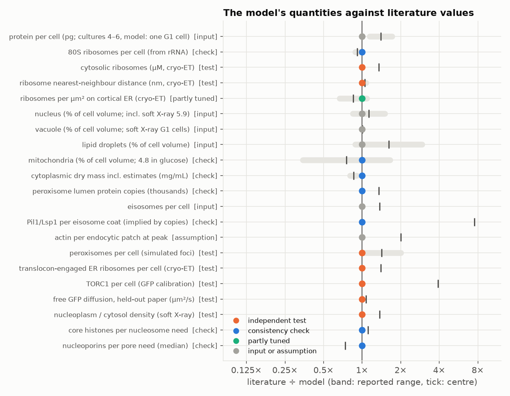

The figure sets single numbers of the model against literature values (the ratio literature ÷ model; grey bands are reported ranges). Grey points are inputs or assumptions, shown for orientation; blue are consistency checks; orange are independent tests. The large outlier is the eisosome: the measured Pil1/Lsp1 copy number implies about 2,500 molecules per eisosome, the built coats hold 327 (3,757 dimers on 23 furrows; build R 333).

# Part A. The static cell

## 1. Composition

| Quantity | Model | Literature | Kind |
|---|---|---|---|
| Protein per cell | 3.5 pg (5.45 × 10⁷ molecules, 1.9 × 10⁶ per µm³ of protoplast) | cultures: 4–5 pg (Carroll *et al.* 2011), 6 pg (Sherman 2002); 1–3 × 10⁶ per µm³ (Dolgalev *et al.* 2023) | input (scaled to 3.5 pg for one unbudded G1 cell, between the anchors below; 5.0 pg through build Q) |
| 80S ribosomes | 211,500 (from ribosomal-protein abundances) | 187,000 ± 56,000 (von der Haar 2008) and about 200,000 (Warner 1999) from rRNA; ~3 × 10⁵ in YPD from a growth-law estimate (Kostinski & Reuveni 2021) | check |
| Pre-ribosomes | 19,500 (8.9% of ribosomes), from stage-specific assembly factors | at ~2,000 ribosomes per minute (Warner 1999), scaled: 2–4 min per stage | check |
| Mitochondrial copy numbers | PaxDb | Morgenstern *et al.* 2017: Spearman 0.86, same mitochondrial mass share, 1.5× larger scale | cross-check of inputs |
| Peroxisome lumen protein | 68,200 placed copies | ~92,000 for the two peroxisomes of a glucose-grown cell (Das *et al.* 2026, absolute peroxisome proteome; a culture average) | check |
| Inventory protein mass | conserved through all assembly steps | proteome total | internal: within 0.4% |

- **Ribosomal proteins (check, failed; found 2026-11-13):** ribosomal proteins are 15.7% of the model's protein mass, against 29–32% in three proteomics datasets of fast-growing yeast (Metzl-Raz *et al.* 2017, SC medium; Björkeroth *et al.* 2020 and Xia *et al.* 2022, CEN.PK in minimal media; none is BY4741 in YPD; shares computed from their supplementary tables, `pipeline/data/validation/literature/g1_cell/`). PaxDb's integrated dataset under-weights them for this condition. A copy-number round is planned; build S still has build R's copy numbers.
- **Structures behind the mass:** PDB 52.0%, AlphaFold complexes 15.4%, AlphaFold monomers 30.1%, Boltz-2 tRNA models 2.6% of placed mass (build S; build R 52.4, 15.0, 30.1, 2.6%). AlphaFold residues with pLDDT < 50 are trimmed (3.4% of placed mass; 15–16% in nuclear and nucleolar proteins), so placed protein is about 2.9 pg of the 3.5 pg inventory.

**The protein scale against counted structures** (`validation/anchors.py`; a check, added after the external review of 2026-11-12). Proteins that exist only in a structure whose number per cell is known say how much protein one cell holds:

| Anchor | Need | Inventory ÷ need at 5.0 pg | at 3.5 pg | Protein total it implies |
|---|---|---|---|---|
| Core histones | 2 of each per nucleosome, 64,487 + rDNA nucleosomes | 1.29 | 0.90 (H3 0.70, H2A 0.77, H4 1.04, H2B 1.31) | 3.9 pg |
| Scaffold and FG nucleoporins (26) | copies per pore (Kim *et al.* 2018) × pores | 1.5 (117 pores) | 1.36 (93 pores; 10th–90th percentile 0.99–2.15) | 2.6 pg |
| Ribosomes | 187,000–200,000 per cell from rRNA | 1.5–1.6 | 1.06–1.13 | 3.1–3.3 pg |

3.5 pg lies between the anchors; they disagree with each other by 1.5-fold, which is the uncertainty of the scale. The outer kinetochore (Ndc80 complex 6–10 times its 8 per kinetochore) is not an anchor, since these proteins have soluble pools. The pore number is itself an assumption (93, from the areal density of 117 pores on the earlier nucleus).

**Per-protein copy numbers** (`validation/copy_numbers.py`). The input (PaxDb integrated, scaled to 3.5 pg) against two absolute proteomes on 4,345 shared proteins: the unified scale of Ho *et al.* 2018 (21 studies, GFP and mass spectrometry; overlapping PaxDb's sources) and the label-free absolute proteome of BY4741 on glucose of Das *et al.* 2026 (not in either). Both are culture averages, so a G1 cell should sit below them:

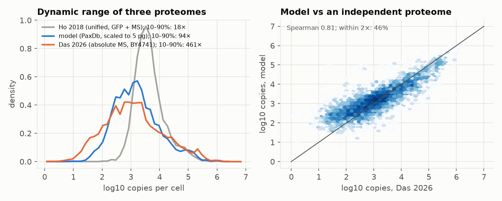

| | Spearman with Das 2026 | Within 2× of Das 2026 | 10th–90th percentile span |
|---|---|---|---|
| Model (PaxDb) | 0.81 | 46% (median 1.23× Das; 42% and 1.75× at 5.0 pg) | 94-fold |
| Ho 2018 | 0.82 | 27% | 18-fold |
| Das 2026 | — | — | 463-fold |

The three agree on ranks but not on dynamic range: Ho's unified scale is compressed (low-abundance proteins are several times higher than in the model; the model's median is 0.37 of Ho's, 0.53 at 5.0 pg), Das's is wider still. The model's input lies between the two published scales and closer to the independent one, so there is no case for replacing it with Ho's. Until build R this check read a per-protein table that was not regenerated with the inventory; the build script now refreshes it.

**Cytoplasmic concentrations by FCS** (`validation/literature_checks.py`): 18 endocytic proteins measured as 3×-tagged fusions in the cytoplasm (Boeke *et al.* 2014): Spearman 0.78 with the model's cytosolic concentrations; the model is 2.3× higher in the median (FCS sees only the freely diffusing pool, not the copies bound to endocytic patches); 44% within 2× (build S; build R 0.77, 2.1× and 50%; the copy numbers are the same, the nucleus/cytosol split and the placement changed).

**Abundance against image intensities** (`validation/image_nc.py`; check): the mean cellular mNeonGreen intensity of 4,886 C-SWAT strains (Dubreuil *et al.* 2019) against the model's copies per cell: Spearman 0.74, 0.81 over the brightest 70% (the dimmest are at autofluorescence).

## 2. Geometry

Organelle volumes measured on the final voxelised geometry, against the literature (`MODEL.md` 3.1):

| Compartment | Model | Literature |
|---|---|---|
| Cell | 34 µm³ with the wall (28.5 µm³ inside the plasma membrane) | set so that 3.5 pg of protein keep the cytosol at about 170 mg/mL. Unbudded G1 cells by soft X-ray tomography: 24.9 µm³ (Chen *et al.* 2025); culture mean 42 µm³ (Jorgensen *et al.* 2002), used through build Q |
| Nucleus | 7% of cell (with the envelope) | fluorescence ~7% across cell sizes (Jorgensen *et al.* 2007): input; soft X-ray 5.9 ± 1.3% in G1 cells; serial-section EM 10.5% (Yamaguchi *et al.* 2011); 8.0% and 9.7% in the two segmented cells |
| Nucleolus | 20% of nucleus | 20% (Uchida *et al.* 2011): input |
| Vacuole | 17.2%, one compartment, sphericity 0.98 (build R 17.1% in 12 carved lobes, sphericity 0.39) | 17.2 ± 6.0% in unbudded G1 cells by soft X-ray tomography (Chen *et al.* 2025): input since build R; one vacuole object in 488 of 490 G1 cells, corrected sphericity 0.98, ellipsoid elongation 1.10 and flatness 1.07 (same study, file S8): input since build S; five segmented cells 6–13% (9% used before) |
| Lipid droplets | 0.34% | five segmented cells 0.3–0.8%; soft X-ray tomography 1% |
| Mitochondria | 2.9% | soft X-ray 1%, serial-section EM 1.7%; **4.77% in glucose** by 3D fluorescence (Di Bartolomeo *et al.* 2020; CEN.PK in minimal glucose medium, a different strain). Raised from 1% and 2% because the mitochondrial proteome did not fit |
| Mitochondrial ultrastructure (build S) | outer diameter median 338 nm (250–414); 14 nm between the membranes; 169 cristae, 16 per µm of tubule, reaching 50–200 nm in; crista membrane 0.24 × the outer membrane; 11 nucleoids, 15 mtDNA copies | 339 ± 5 nm in glucose (4Pi; Egner *et al.* 2002), median 330 nm in cryo-tomograms of BY4741 in YPD (Chang *et al.* 2025); 13–16 nm there; crista membrane 0.28 × the outer membrane and median crista depth 85 nm on the YPD meshes of EMPIAR-12534 (measured here); 1.2–1.35 nucleoids per µm (Osman *et al.* 2015); 21 ± 4 mtDNA per haploid cell in YPD (Göke *et al.* 2020): all inputs. Build R: 300 nm tubules, 8 nm, a disc every 42 nm (1.4 × the outer membrane), 15 nucleoids with 35 copies |
| Soft X-ray tomography, unbudded G1 cells in YPD (Chen *et al.* 2025; BY4741, n = 287) | — | cell 24.9 µm³; vacuole 17.2 ± 6.0%, nucleus 5.9 ± 1.3% of cell volume; lipid droplets 0.37% (all droplets summed). Mitochondria not segmented |
| Cortical ER | covers 48% of the plasma membrane | Wolf *et al.* 2012: input |

- **Shape statistics** (`scripts/organelle_stats.py`): up to build R the vacuole lobes, corrected for the segmentation's lost caps, had a surface-to-volume ratio of 7.8 µm⁻¹, inside the 6.8–9.9 µm⁻¹ of the segmented cells. The single vacuole of build S has 16.0 µm² on 5.84 µm³ (2.7 µm⁻¹): the segmented cells (log phase, vacuoles 6–13% of the cell) and the soft X-ray G1 cells (one round vacuole) disagree, and build S follows the latter.
- **Membrane structures:** 23 eisosome furrows, 268 nm long on average and 50 nm deep (about 30 per cell in larger cells; Strádalová *et al.* 2009, Karotki *et al.* 2011; the number follows the plasma-membrane area); 93 nuclear pores (10.8 per µm², the density of the 117 of Winey *et al.* 1997 on the earlier nucleus; since build S none in the nucleus–vacuole junction); 29 endocytic sites; one bud scar 1.0 µm across (AFM; Pillet *et al.* 2014). All inputs or assumptions.
- **Relative densities by soft X-ray absorption** (Chen *et al.* 2025): nucleus 0.90 and mitochondria 1.10 of the cytosol's linear absorption coefficient. The model's macromolecule densities relative to the cytosol are 0.65 (nucleoplasm) and 1.05 (matrix) in build S (build R 0.66 and 0.89; matrix 0.65 through build M, 0.78 in build P). Absorption counts all organic matter (lipids, small molecules) and the mitochondrial value includes membranes, so only the direction is compared: the nucleoplasm is too dilute; the matrix now holds 98.5% of its proteins (section 3) and is near the measured ratio.
- **Known deviations:** the cell is larger than G1 cells by soft X-ray (34 vs 25 µm³; section 15a); the nucleus is smaller than in serial-section EM (7% vs 10.5%); mitochondria are smaller than in glucose-grown CEN.PK (2.9% vs 4.8%). Golgi, endosomes and peroxisomes (1% together) are an assumption. The organelle fractions come from different studies and strains. The mitochondria are procedural (two tubular networks in build S), and there is no bud.

## 3. Packing

`scripts/s4_validate.py`, `work/results/wholecell3d_validation.json`; `validation/placement_checks.py`, `work/validation/placement_checks.json` (since build S).

| Check | Value (build S) | Build R | Acceptance |
|---|---|---|---|
| Residue beads closer than 0.3 nm to a bead of another molecule, packed molecules | 3.4 × 10⁻⁶ (18 of 5.3 M sampled; none across tile borders; 8 are Pab1 or eIF4E on their own mRNA end) | 6.4 × 10⁻⁶ (builds N–Q 3.7–9.3 × 10⁻⁶) | < 10⁻⁵ |
| The same, including the built actin structures | 1.87 × 10⁻⁵ (99 beads: tropomyosin on its filament 33, filament on filament 18, among others) | 2.65 × 10⁻⁵ (133 beads) | < 10⁻⁵ (failed) |
| Beads outside their region | 6.7 × 10⁻⁵ of 19 M (0.047% of instances) | 4.1 × 10⁻⁵ (0.04%) | — |
| Membrane proteins within 1° of the membrane normal | all of 10,000 sampled | all | — |
| Transmembrane residues within 2 nm of the bilayer midplane | 97.4% (median 0.72 nm) | 97.3% (0.73 nm) | — |
| Copies placed / requested, outside mitochondria | 99.5% (overall 99.3% of the request, 99.1% of the inventory) | 98.9% (97.5%) | ≥ 99% (passed; failed narrowly in build R) |
| Placed share of the inventory by sphere volume | 98.1% | 96.0% | — |
| Species under half / under 80% of their inventory copies | 10 / 60 of 4,469 | 76 / 238 | — |
| Tile seams: sphere volume fraction within 5 nm of a tile face, first / last pass, against the interior (918 cytosolic tiles) | 0.41 / 0.40 against 0.41 | 0.49 / 0.20 against 0.40 | — |
| Membrane-face copies with the centre outside their shell (+4 nm) | 0% in all seven shells | 4–17% (Golgi 17%, envelope 11%) | — |

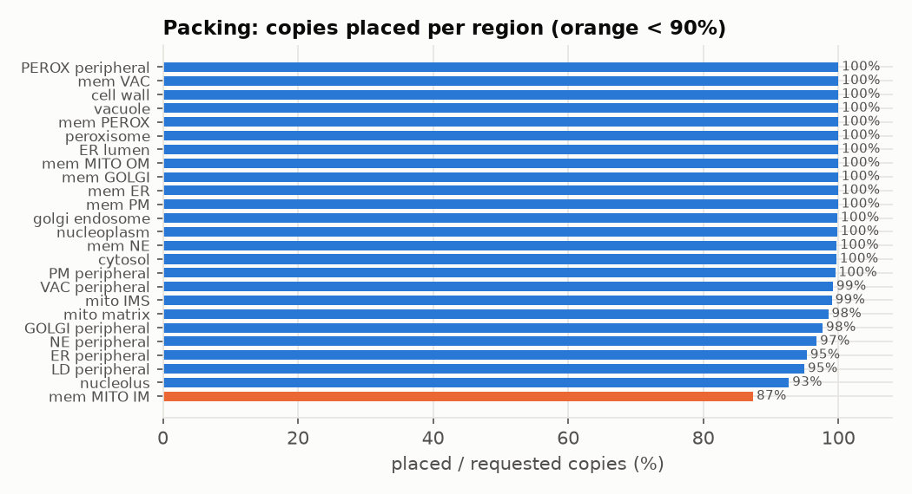

**Overlaps inside the built actin structures (found in build R).** The overlap check samples 64 cubes. In build R its total rose above the limit, and the pairs involved showed why: 101 of the 133 overlapping beads lie between components of the explicitly built actin structures (tropomyosin on the filament it coats, neighbouring filaments of a bundle, Arp2/3 at its branch junction); in build S, 81 of 99. 0.25–0.5% of the beads of these structures overlap in every build (101 of 36,786 sampled in build R, 81 of 17,154 in build S); the smaller cell has the same cortex in less volume, so the cubes hold more of it. Four other cube samples of build R gave 3.8–6.6 × 10⁻⁶ for the packed molecules. The check reports both rates; acceptance uses the packed molecules, and the total is kept as a second flag, which fails. The geometry of the actin builders is not fixed.

**Containment rose (build S, not analysed).** 6.7 × 10⁻⁵ of the sampled beads lie outside their region, against 4.1 × 10⁻⁵ in build R and 9.1 × 10⁻⁵ in round S candidate build 1. The packer tests its packing shapes against the compartments, not the residue beads, and the finer shapes of build S (15 residues per sphere) fit closer to the walls; whether that is the cause has not been checked.

**Round S: what changed in the packing (2026-11-13).** Four changes, each measured before it went into the build (`MODEL.md` 8.2):
- **Rounds against tile seams.** Tiles are packed in 8 passes; with one visit per tile, first-pass tiles over-filled the 5 nm at their faces (molecules protrude into still empty neighbours) and last-pass tiles under-filled it (build R: 0.49 and 0.20 against 0.40 inside). Every tile is now visited in 6 rounds by size class, with the pass order reversed in every second round: 0.41 and 0.40 against 0.41.
- **Shell caps.** A membrane-face shell is asked for at most the cytosol's requested sphere volume fraction (0.41); the rest of its copies go to the cytosol as the soluble pool. The Golgi/endosome face (asked 0.67) keeps 0.61 of every species (141,000 copies to the cytosol), the envelope face (0.51) 0.80 (8,000 copies). Proposals next to a partner and moves of the squeeze must stay in the shell: no shell copy lies outside it (build R: 4–17%).
- **Finer packing shapes.** The library sphere trees (about 30 residues per sphere) claim 2.4 times the volume of the residue beads in the matrix, 1.9 in the cytosol and 3.8 in the nucleolus. Packing now uses 15 residues per sphere: on six matrix-rich test tiles of build R, 93.1% of the matrix request placed instead of 87.9%, 3 species under 80% instead of 13, at 2.6 times the CPU time (8 residues: 94.9%, 9 species, 7 times).
- **Uniform thinning.** A region asking for more than 1.1 times the cytosol's fraction is packed in a 16-tile pilot first; if the pilot held less than 98%, every species of the region is cut to 0.97 times the share held. In build S only the nucleolus is thinned (asked 0.64, held 0.935, factor 0.907); the matrix pilot held 0.991. This replaces a shortfall that fell on mid-sized species (build R: Hsp60 49%, Sod2 37% placed; build S: 97% and 89%) by one reported factor.

**Remaining shortfalls (partial).** The matrix holds 98.5% of its proteins at 178 mg/mL (build R 75% and 150 mg/mL; 65% and 132 mg/mL in build P; 40% and 107 mg/mL when mitochondria were 2% of the cell) and the intermembrane space 99.0% (87%). The nucleolus holds 92.7% of its thinned request, 84.1% of its inventory (build R 80%): it is thinned, not filled. New in build S, the mitochondrial inner membrane holds 87.4% of its proteins (build R 98.2%): the rebuilt mitochondria have 13.1 µm² of inner membrane instead of 31.5, and carriers lose most (Yhm2 40%, Ggc1 42%, Odc1 and Odc2 37–38%); membrane regions are not thinned. The cytosolic faces of lipid droplets (95.0%), ER (95.3%) and nuclear envelope (96.8%) still lose a few percent. Cytosolic proteins stay sparse in the shell layer next to Golgi and endosome membranes (0.16 of their density further out), where the membrane-face proteins are. Densities and proximity statistics of the nucleolar and inner-membrane proteins are underestimated. Whether the compartment volumes are too small or the packing (random sequential addition plus a local squeeze relaxation) cannot reach the real density is not known.

## 4. Densities and dry mass

Mass of placed macromolecules per compartment volume (`MODEL.md` 10):

| Compartment | Total, build S (mg/mL) | Total, build R (mg/mL) | Total, build P (mg/mL) | Protein / RNA+DNA, earlier build (mg/mL) | Dry volume fraction, earlier build |
|---|---|---|---|---|---|
| Cytosol | 170 | 168 | 170 | 129 / 36 | 11.4% |
| Nucleoplasm | 111 | 110 | 106 | 99 / 7 | 7.6% |
| Nucleolus | 167 | 164 | 166 | 108 / 28 | 9.5% |
| Mitochondrial matrix | 178 | 150 | 132 | 101 / 6 | 7.7% |
| Mitochondrial intermembrane space | 25 | 14 | 16 | — | — |
| Golgi / endosome lumen | 2 | 2 | 3 | 2 / 0 | 0.2% |
| Peroxisomes | 97 | 97 | 120 | 120 / 0 | 8.7% |
| ER lumen | 21 | 21 | 25 | 44 / 0 | 3.2% |
| Vacuole lumen | 1 | 1 | 3 | 3 / 0 | 0.2% |

The cytosol, nucleoplasm and nucleolus kept their densities when the cell was made smaller: the cell volume was chosen for that, so that the diffusion calibration (section 9), which depends on cytosolic crowding, stays valid. In build S the matrix is denser because it now holds 98.5% of its proteins, and the intermembrane space because it is smaller (0.18 against 0.27 µm³) and fuller (99% against 87%).

**Check against dry-mass measurements (partial).** Measured cytoplasmic dry-mass densities are around 200 mg/mL and include everything. In build R, the model's macromolecules (about 160 mg/mL averaged over the cytoplasm without the vacuole; 158 in build S), plus the residues missing from structures (about +20), internal-membrane lipids (30–35; about 0.8 pg in 22.7 µm³, the membrane area hardly shrank with the cell) and small molecules (estimated 30–40) give about 240–255 mg/mL, above the measurements; the larger cell of builds J to Q gave 225–240. Build S has 115 µm² of internal membrane instead of 160 (one round vacuole, short cristae), so its lipid term is smaller; it was not re-estimated. The small-molecule term is the least certain. Refractive-index tomography gives 205–225 mg/mL for wild-type cells in glucose with the vacuole excluded (Kunzi *et al.* 2026, a preprint; read from their Fig. 1B). The same study's whole-cell protein concentration (71 mg/mL by Bradford assay, normalised to the Coulter volume) is now closer: the model has 103 mg/mL (3.5 pg in 34 µm³), against 119 before. **Two measurements pull the cell volume in opposite directions:** the dry mass would be matched with the same protein in about 36–38 µm³, the cryo-ET ribosome concentration (23 µM against the model's 17) in about 26 µm³ (both estimated on build R). Builds R and S sit between them; the volume was set by keeping the cytosol's density, not by either.

## 5. Assemblies built explicitly

Structures built before the random packing, with the checks run on them (`MODEL.md` 5–6):

| Structure | Check | Result | Kind |
|---|---|---|---|
| Membrane orientation method | reproduces hand-oriented Pma1 and V-ATPase | z-coordinate correlation 1.000 and 0.9996 | internal |
| Membrane orientation, AlphaFold monomers | topology sides | a bug left 39 inner-membrane proteins upside down (TIM50, TIM21, Mgm1); found and fixed. Stage 0 (round S) found 82 more transmembrane proteins rotated by 180° in library entries that predated the fix (61 packed in build R, 42,800 copies); rebuilt for build S | internal |
| Rabl chromatin | 32 telomeres in 7 foci at the nuclear envelope (6–8 seen by immunofluorescence; Gotta *et al.* 1996) | all 32 within 150 nm of the envelope (median 94 nm), median 164 nm from target; telomere–pole distance follows arm length (Spearman 0.92, the trend of Duan *et al.* 2010 and Therizols *et al.* 2010; build R 112 nm and 0.85) | check |
| Nucleosomes | 64,487 measured dyads on the chromosome arms | 62,882 placed (the rest evicted by Pol II and origins, or no room) | internal |
| Transcribing Pol II | 691 engaged per cell (Pelechano *et al.* 2010), not scaled | 505 of 654 placed on their genes, 3 nucleosomes evicted around each | internal |
| Nuclear pores and FG mesh | 93 pores (7N9F), every nucleoporin in its measured copies per pore (Kim *et al.* 2018); none in the nucleus–vacuole junction (Severs *et al.* 1976, as cited by Kohler & Büttner 2021) | FG repeats: 4.9 of 5.5 million residues placed (89%); nucleoporin pools beyond 1.25 times the pores' need are not placed | internal |
| Eisosome coat (8QB7/8QB8 lattice) | inserted helix on the furrow membrane | all sampled within 2 nm (median 1.36 nm) and all other residues on the cytoplasmic side (builds R and S; 99.2% and 98.9% in an earlier build) | internal |
| Eisosome coat | share of the cell's Pil1/Lsp1 | 7.6% (3,757 dimers on 23 furrows; build R 7.4%); copy numbers imply ~2,500 per eisosome | failed |
| ATP synthase dimers | TM residues within 2 nm of the inner membrane | 98.8%; 1,940 dimers fill 72% of the 2,703 crista rim sites tried (build R, with a crista disc every 42 nm: 6,257 dimers, 52% of 11,935 sites) | internal |
| Mitoribosomes | membrane-tethered (Pfeffer *et al.* 2015) | 1,364 of 1,367 monosomes placed (build R 1,311); exit site 5.1 nm above the leaflet | internal |
| Polysomes | assumed 70% of cytosolic ribosomes | 62% placed in chains (116,723 on 17,566 mRNAs; build R 61%; 44% before gene-specific mRNAs) | partial |
| Ribosome-free mRNAs | a median 72% of a gene's mRNA on ribosomes by polysome profiling (Arava *et al.* 2003, Supplementary Table 3) | 570 of 18,136 mRNAs carry no ribosome (97% translated; compared on build R, the same mRNA draw as build S) | failed |
| Full-length mRNA | 18,136 gene-specific mRNAs (25,911 times 0.7) | 85% of the nucleotides placed | internal |
| ER-associated ribosomes | 550–900 per µm² on cortical ER (West *et al.* 2011) | build S: 827 per µm² (19,300 ribosome centres within 30 nm of the cortical ER: docked, packed in the band, and on the ER-tethered polysomes; 23.3 µm², `validation/er_ribosome_density.py`); build R 796; builds N–P 785; build M ~470 | reproduced |
| Translocon-engaged ribosomes | 7,715 per cell by cryo-ET and modelling (Wu *et al.* 2026) | 5,586 docked on Sec61/Ssh1 (80% of free translocons, an assumption; build R 5,507); 7,703 at 5.0 pg. The measured count is for the authors' model of a 35.7 fL haploid G1 cell on galactose with about 356,000 ribosomes (round-3 data, 2026-11-13), so the shortfall is real | failed |
| TORC1 | about 200 per growing cell by GFP calibration (Prouteau *et al.* 2017) | 54 instances containing Kog1 (4× fewer; build R 51; 66–75 at 5.0 pg; whether "TORC1" counts complexes or dimers is not stated) | failed |
| Endocytic sites | Rvs161/167 per site at scission ~100 (Picco *et al.* 2015); tip radius 11.6 ± 2.6 nm and depth ~100 nm, up to 140 nm at scission (Kukulski *et al.* 2012 data in Picco *et al.* 2018); ribosome exclusion zone 181 ± 41 nm across (Picco 2018; Buser & Drubin 2013) | 422 of 695 Rvs dimers fit on 29 sites (build R 386 of 748); 1,500 actin per patch vs ~3,000 measured at peak; tubes 40 nm across; depths drawn 0–100 nm (deepest 92 nm in round S candidate build 1); no exclusion zone | failed |
| Active rDNA | 50 Pol I per gene (Miller spreads; French *et al.* 2003) | 73 of 75 genes placed; 57% of nascent pre-rRNA fits in the smaller nucleolus (58% before build R) | check |
| mtDNA nucleoids | 1.2–1.35 nucleoids per µm of tubule (Osman *et al.* 2015); 21 ± 4 genomes per haploid cell in YPD (Göke *et al.* 2020), 0.45 per fL (Seel *et al.* 2023) | 11 nucleoids with 15 genomes in crista-free stretches (build R: 15 nucleoids, 35 genomes); 90% of each nucleoid within 53 nm of its centre (build R 63 nm) | internal |
| Cvt complex | one complex next to the vacuole | radius 84 nm (168 nm across), close to a 150 nm Cvt vesicle (build R 162 nm; 180 nm across at 5.0 pg) | reproduced |

### mRNA and polysomes

Every mRNA is a transcript of a named gene (Pelechano *et al.* 2010 copies). Its length and ribosome load are per gene: TIF-seq UTRs, PAL-seq poly(A) and ribosome-profiling translational efficiency. Linkers between ribosomes are flexible single strands, with random (exponential) free lengths since build N. Polysomes of the 170 expressed genes called in mitochondrial proximity ribosome profiling (Williams *et al.* 2014, glucose) are tethered to the outer membrane, and since build N those of 603 expressed ER-enriched secretome genes (Jan *et al.* 2014, Sec63 proximity) to the cortical ER (gene counts of build P; in builds R and S, with 0.7 times the mRNAs, 147 and 556 genes are expressed and tethered). Pab1 and eIF4E sit on the ends (`MODEL.md` 6.5). Scripts: `validation/mrna_stats.py`, `mrna_localization.py`.

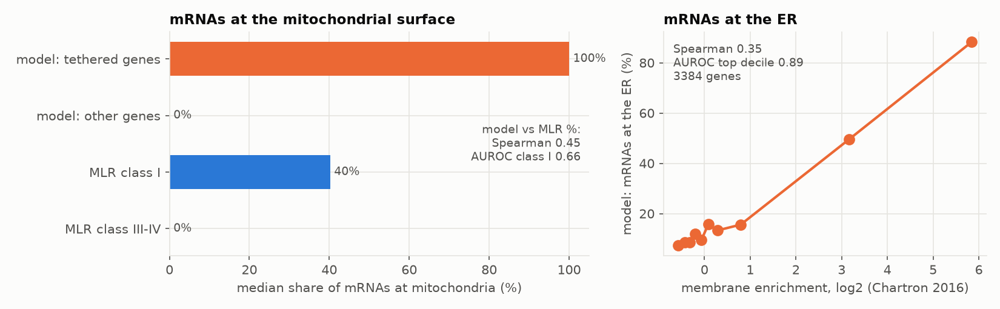

- **mRNAs at mitochondria (test):** the share of each gene's mRNAs with a ribosome within 50 nm of the outer membrane, against the share found in the mitochondrial fraction by Saint-Georges *et al.* 2008, which was not used. Over 561 genes Spearman is 0.45, and the AUROC for their strongly localized class I against classes III–IV is 0.66 (build S; R 0.35 and 0.61, Q 0.44 and 0.68, P 0.41 and 0.66, O 0.41 and 0.65, N 0.41 and 0.66; L 0.38 and 0.62; M 0.44 and 0.66). Builds R and S have 0.7 times the mRNAs of Q, so a gene's share near mitochondria rests on fewer molecules and fewer class I genes are expressed in the draw (175 against 199); the rule did not change. Builds R and S share the mRNA draw and the tethers (275 polysomes of 147 genes) and differ in geometry and packing, so their difference (0.35 against 0.45) shows how much one realisation moves this test: the drop in build R was not a property of the smaller cell. The untethered build K gives −0.05 and 0.47. The comparison is cross-condition (their cells grew in galactose). The model is all-or-none per gene: every polysome of a called gene is tethered, while fractionation finds a median 43% of class I mRNAs on mitochondria.
- **mRNAs at the ER (test, builds N to P):** the share of each gene's mRNAs with a ribosome within 50 nm of the cortical ER, against its log2 membrane-polysome enrichment by fractionation in YPD (Chartron *et al.* 2016; not used). Over 3,384 genes Spearman is 0.35, and the AUROC for the top decile of enrichment is 0.89 (builds R and S; N–P 0.35 and 0.90–0.91 over 3,704 genes); without the ER tether (build M) −0.08 and 0.49. The input (proximity labelling at the translocon in glucose) and the test (membrane fractionation in YPD) are different methods; both depend on the same biology, signal sequences and transmembrane domains, so a sequence-only rule would also score well here.
- **Ribosomes on mRNA:** 116,723 in build S (62% of cytosolic 80S; build R 115,139 and 61%, as in builds O to Q; against the assumed 70% and 75–85% in the literature), on 17,566 translated mRNAs (mean 6.6 ribosomes, median 5). The earlier generic mRNAs held 44%.
- **Ribosome-free mRNAs (check, failed; round-3 data, 2026-11-13):** only 570 of the 18,136 mRNAs carry no ribosome, so 97% are translated, while polysome profiling finds a median of 72% of a gene's mRNA on ribosomes (Arava *et al.* 2003, Supplementary Table 3, 3,238 genes compared on build R; the mRNA draw of build S is the same). Per gene, ribosomes per mRNA agree at Spearman 0.44 over all genes and 0.77 for genes with at least 10 translated mRNAs in the model; density falls less steeply with length in the model (log-log slope −0.45 against −0.74). Computed ad hoc, not yet a script in `validation/`.
- **mRNP ends:** Pab1 on 15,299 of 18,136 3′ ends and eIF4E on 17,529 of 18,121 5′ ends (internal; build S; build R 15,046 and 17,425).
- **Collided ribosomes (test, partial; round P):** where a drawn linker is at most 5 nt, the trailing ribosome now takes the pose of the yeast collided disome 6I7O (moved 4.75 nm apart so the coarse sphere trees clear). The frequency follows from independent ribosome loading alone. 3.8% of cytosolic ribosomes are in collided pairs (builds R and S; P 3.9%), against 5.8% by disome profiling (Zhao *et al.* 2021, not used); build O had none, since random orientations clash before neighbours come that close. Independent loading without elongation pauses is the likely reason for the shortfall.
- **Tightly packed polysomes (partial):** in build S, 10.2% of cytosolic ribosomes (R 10.0%, P 10.4%, O 7.2%, N 7.0%) are in tight pairs, counting the collided pairs (4.8 nm exit-to-entry in the structure) and others with an exit-to-entry distance under 8 nm, against 14.5% and 18.6% in two cryo-ET studies (Goetz *et al.* 2025, a preprint; Xie *et al.* 2024); build M had 1.4%. Two changes: free linker lengths are now exponential around each mRNA's mean (independent loading, instead of one spacing per mRNA), and the polysome walk keeps a drawn linker while it tries 40 orientations (before, a short linker that collided was replaced by a new, mostly longer one). Exit-to-entry distances: median 13.7 nm, 5–95% 7.8–31.9 nm (build S; build R 13.8 and 7.8–32.0 nm). The collided pairs have the stacked orientation of the disome structure; other tight neighbours are still randomly oriented.
- **Compaction (not tested):** 5′–3′ end distances of 46–139 nm by length class (medians, build S; build O 46–141 nm). No yeast smFISH measurement of mRNA end-to-end distances was found; human-cell data suggest translating mRNAs are much more compact.

### Ribosomes against in-situ cryo-electron tomography

`validation/ribosome_cryoet.py`. Two independent datasets: the cytosolic ribosome concentration measured by template matching in tomograms of log-phase cells (about 23 µM; Delarue *et al.* 2018), and 91,125 ribosome picks in 249 lamella tomograms of the CZ cryoET Data Portal (dataset 10007; Rangan *et al.* 2024).

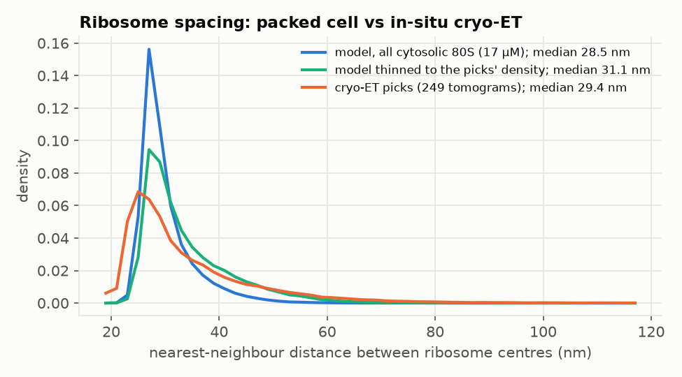

- **Concentration:** 189,700 cytosolic 80S in 18.4 µm³ is 17.1 µM, 25% below the cryo-ET value (build S; build R 188,400 and 17.0 µM; build Q: 274,300 in 26.6 µm³, 17.1 µM). The smaller cell did not change this: cytosol and ribosomes shrank together. Closing the gap would take a cytosol of about 13.6 µm³ for these ribosomes (estimated on build R), which the dry-mass check argues against (section 4).
- **Spacing:** the median nearest-neighbour distance is 28.5 nm in the model (build R 28.6 nm) and 29.4 nm in the tomograms (per-tomogram medians 29–34 nm). The picks are incomplete; thinning the model to the picks' density lengthens its distances to 31.1 nm, so real ribosomes are packed somewhat closer locally than in the model.
- **Shape of the distribution:** the model's distances pile up at 27 nm, set by its fixed 25–31 nm polysome spacing; the tomograms show a broader distribution peaking at 24–25 nm. Polysomes in cells are more compact and more variable than the model's rule.

## 5a. Chromatin and the genome

Chromatin is built from a measured nucleosome map (`MODEL.md` 6.3): 64,487 dyads called on the H3 chemical-cleavage maps of Chereji *et al.* 2018, minus those inside promoter nucleosome-depleted regions (Rossi *et al.* 2021). They are placed in genomic order along a worm-like backbone per chromosome arm, from its kinetochore to its telomere focus. Every nucleosome carries its genome position, so genes, Pol II, origins and chromatin proteins sit at their loci. Scripts: `validation/chromatin_stats.py`, `hic_test.py`, `nucleosome_test.py`.

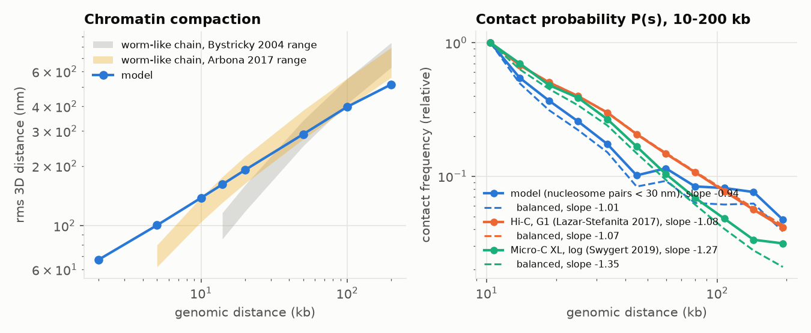

**Fibre geometry: a failure, then a choice.** The first fibre took the compaction and persistence measured by imaging (Bystricky *et al.* 2004: 130 bp/nm, 195 nm), with nucleosomes within 20 nm of the backbone. It matched imaging at 14–20 kb but failed the Hi-C test, which no part of the build had used. Nine variants were then built as pre-passes only (chromatin, microtubules and kinetochores, without the rest of the cell). A first scan led to the choice below; it then turned out that the fibre walk did not steer the arms to their telomere foci (they ended a median 790 nm away; the walk randomised its direction after every failed placement, and short arms had targets beyond their own contour). The table is the scan repeated after that fix; the choice did not change:

| Variant | R(s) 20 / 100 kb (nm) | cis share | P(s) slope | CEN clustering |
|---|---|---|---|---|
| earlier walk (12.5 nm steps) | 205 / 326 | 0.46 | −1.06 | 4.3× |
| Bystricky, radius 20 nm | 146 / 350 | 0.63 | −0.84 | 7.0× |
| Bystricky, radius 40 nm | 162 / 376 | 0.55 | −0.92 | 7.2× |
| Bystricky, radius 60 nm (chosen) | 197 / 411 | 0.47 | −0.96 | 7.0× |
| Bystricky, radius 90 nm | 233 / 467 | 0.44 | −1.11 | 13.1× |
| Bystricky, radius 120 nm | 241 / 458 | 0.43 | −1.05 | 7.0× |
| Arbona 2017 (60 bp/nm, 70 nm), radius 20 / 40 nm | 172–181 / 370–372 | 0.47–0.53 | −0.93 to −0.98 | 7.7–10.2× |
| 90 bp/nm, 120 nm, radius 30 nm | 158 / 362 | 0.54 | −0.89 | 8.0× |
| **Data** | Bystricky 118–160 / 412–552; Arbona 163–223 / 393–553 | 0.37 (G1), 0.41 (log) | −1.09 (G1), −1.27 (log) | 4.0 (G1), 5.3 (log) |

The 60 nm radius was chosen because it is the only variant whose R(s) lies inside the chain inferred from imaging and Hi-C together by Arbona *et al.* 2017 at both 20 and 100 kb, and inside Bystricky's at 100 kb (above it at 20 kb). Dense 20–40 nm clutches make the chromosomes too territorial, and in-situ cryo-ET of yeast nuclei finds dispersed nucleosomes rather than a compact fibre. The Hi-C comparison was looked at in this choice, so it is *partly tuned* from here on.

**The contact maps depend on their normalisation (2026-11-12).** The G1 map is used as raw counts and the log-phase map as its authors' ICE-balanced values. Re-balancing both the same way (iterative correction over the 16 nuclear chromosomes, the diagonal and the 2% least covered bins removed; `hic_test.ice`) moves the log-phase measures a lot: cis share 0.41 to 0.51, centromere clustering 5.3× to 7.2×, telomere clustering 26× to 3.6×. The two maps' chromosome-pair patterns agree with each other at Spearman −0.04 as provided and 0.15 balanced, so that measure cannot show much either way. Since then the model is also scored balanced the same way (keys `*_ice` in `hic_test.json`). The comparisons below give both.

| Measure (ICE-balanced) | Build M | Builds N, O | Builds P, Q | Build R | Build S | G1 Hi-C | Log-phase Micro-C XL |
|---|---|---|---|---|---|---|---|
| Cis share | 0.57 | 0.54 | 0.55 | 0.51 | 0.50 | 0.39 | 0.51 |
| P(s) slope, 10–200 kb | −1.03 | −1.16 | −1.03 | −1.04 | −1.01 | −1.07 | −1.35 |
| Centromere clustering | 6.4× | 5.5× | 7.1× | 6.0× | 5.9× | 4.0× | 7.2× |
| Telomere clustering | 3.0× | 2.5× | 2.3× | 1.9× | 3.3× | 1.7× | 3.6× |
| Chromosome pairs, Spearman with the model | 0.12 (G1), 0.30 (log) | 0.04 (G1), 0.20 (log) | 0.08 (G1), 0.29 (log) | −0.03 (G1), 0.15 (log) | 0.14 (G1), 0.14 (log) | data vs data: 0.15 | |

Processed alike, builds M to P lie inside the range spanned by the two maps for centromere and telomere clustering and (N, O) contact decay; only the cis share is still high. Build P uses the same chromatin rules as O, but the round-P SPB is an obstacle for the fibre walk, so the random realisation changed: contact decay became slightly flatter than both maps (−1.03) and centromere clustering rose from 5.5× to 7.1×. One realisation moves these measures by that much, so differences of this size between builds are not evidence for or against a rule.

**Build R, in the smaller nucleus (2.0 µm³ instead of 2.9).** The chromatin rules are unchanged. Balanced, the cis share (0.51) and both clustering measures are inside the range of the two maps; the contact decay is slightly flatter than both. Builds with identical rules differ by this much from one realisation to the next (O against P), so this is not evidence for the smaller nucleus. Distances along the chromosome shorten above 50 kb: rms 195, 284, 376 and 467 nm at 20, 50, 100 and 200 kb (build Q: 193, 294, 403, 536). At 100 kb the chain is now 4% below the range of Arbona *et al.* 2017 (393–553 nm), inside which the fibre radius had been chosen, and at 200 kb further below it (561–792 nm): **the long-range compaction got worse in the smaller nucleus.** Rabl geometry: arms end a median 164 nm from their telomere focus; telomere-to-SPB distance against arm length, Spearman 0.85.

**Build S, with the nucleolus turned towards the vacuole and the spindle pole body to open cytoplasm (round S).** The chromatin rules are unchanged; the nucleolus and the spindle pole body are on the other side of the nucleus, so the chromatin is a new realisation. Balanced, the cis share (0.50), centromere clustering (5.9×) and telomere clustering (3.3×, up from 1.9×) are inside the range of the two maps; the contact decay is flatter than both (−1.01). Distances along the chromosome: rms 191, 289, 398 and 516 nm at 20, 50, 100 and 200 kb, so 100 kb is back inside the Arbona range (393–553 nm) and 200 kb is still below it (561–792 nm). Telomeres: median 94 nm from the envelope, 164 nm from their focus, Spearman 0.92 against arm length. Builds R and S differ by about as much as builds O and P did: realisation noise, which replicate builds at other seeds would measure.

**A relaxed polymer instead of the fibre walk (tested, not adopted).** After the Jurkat cell model, each arm was simulated as a coarse polymer in OpenMM:
- 2 kb beads, with Arbona's 60 bp/nm and 70 nm persistence;
- soft excluded volume, confined to the nucleoplasm;
- centromeres tethered at their kinetochores, telomeres near the envelope, no telomere foci imposed.

The measured nucleosomes were then placed along the relaxed chain (`chromatin_polymer.py`, `validation/chromatin_polymer_scan.py`). Results, ICE-balanced, over 4–8 replicas per variant (longer runs, weaker repulsion, Bystricky's chain, looser telomere tethers):
- **Contact decay:** better, slope −1.24 to −1.42.
- **Cis share:** worse, 0.63–0.77.
- **Centromere clustering:** worse, 8–20×.
- **Chromosome pairs:** not reproduced; the best value, 0.25, came from an 8-replica ensemble.

Equilibrium relaxation with the same constraints makes chromosomes more territorial, not less, so the fibre walk stays. Hi-C was looked at in this decision.

**Built cell (N), against the two contact maps** (as provided; the balanced values are in the table above):
- **Within chromosomes:** 49.1% of contacts (G1 Hi-C 36.9%, log-phase Micro-C XL 40.9%; M 50.5%). Chromosomes are still somewhat more territorial than in cells.
- **P(s) slope over 10–200 kb:** −1.06 (G1 −1.09, log −1.27; M −0.92). Build L, whose arms missed their telomere foci, gave −1.33; that closer match was an artefact of the steering bug.
- **Centromere clustering:** 5.5× the mean trans contact (G1 4.0, log 5.3; M 7.6×). Build N adds the outer kinetochore (DASH rings and Ndc80 complexes) around the kinetochore-microtubule plus ends, which keeps the centromere-proximal chromatin further apart; single cells vary, so part of the change may be chance.
- **Telomere clustering:** 2.9× (G1 0.53×, log 26× as provided, 1.7× and 3.6× balanced).
- **Chromosome-pair pattern:** Spearman 0.24 (G1) and 0.04 (log) as provided, 0.04 and 0.20 balanced. The two maps agree with each other at −0.04 and 0.15, so the measure cannot discriminate.
- **Rabl geometry (internal):** arms end a median 146 nm from their telomere focus (L: 760 nm), and the telomere-to-SPB distance follows arm length (Spearman 0.90). This is a check of the build rule, not a test.
- **Compaction:** R(s) is 196 nm at 20 kb, 411 nm at 100 kb and 550 nm at 200 kb: inside the Arbona *et al.* 2017 range at 20 and 100 kb, slightly below it at 200 kb (561–792 nm); against Bystricky above the range at 20 kb, inside at 100 kb and below at 200 kb.

In the viewer, nucleosomes can be coloured by the histone mark of the nearest unstressed MNase nucleosome (Weiner *et al.* 2015; annotation only, the marks do not change the structure). Below, H3K4me3:

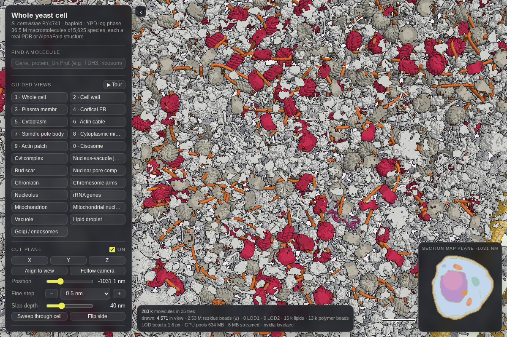

**Nucleosome positions (held out: none of these data entered the build):**
- **Count:** 62,882 placed after Pol II and origin evictions (build S; build R 62,886), against 57,000–60,000 per cell by absolute occupancy (Oberbeckmann *et al.* 2019). A population map holds positions that a single cell does not all occupy.
- **Occupancy at 13,807 restriction sites:** 0.75 at sites under a model nucleosome and 0.57 elsewhere (AUROC 0.75; builds R and S, 0.755 and 0.755).
- **MNase map (Weiner *et al.* 2015, unstressed):** 79% of its nucleosomes have a model dyad within 40 bp.
- **ATAC-accessible regions (Schep *et al.* 2015):** 10% fewer model dyads per kb than the genome average (merged regions of 1.3 kb, so a coarse test).
- **DNase I at base resolution (round Q; `validation/dnase_test.py`):** 83 million cuts in log-phase W303 in YPD (Zhong *et al.* 2016; two replicates, lifted from sacCer2). Around the model's dyads the cut density dips to 0.62 of the genome mean and rises to 1.04 in the linkers 75–95 bp away; nucleosome cores (±50 bp) are cut 0.66 times as often as linkers, and 76% of nucleosomes are cut less in their core than in their own linkers. In 50 bp bins, stretches without a model nucleosome are cut 2.3 times the mean and covered ones 0.71 times.
- **DNase-hypersensitive sites (Zelin *et al.* 2012; BY4741, 3,260 peaks):** model occupancy 0.62 inside them against 0.76 genome-wide.
- **What these test:** the chemical-cleavage map behind the model (an input) and what the model kept of it, against independent assays. They do not test the 3D fibre.

**Silent chromatin (round Q; `pipeline/silent_chromatin.py`, `validation/silent_chromatin_test.py`).** Through build P every nucleosome within 3 kb of a chromosome end and in HML/HMR carried Sir proteins (529 nucleosomes). Now the Sir-bound nucleosomes are those where Sir3 ChIP-seq of cycling cells is enriched at least 5-fold over input in both replicates (Brothers & Rine 2022), within 30 kb of an end or in HML/HMR: 234 placed nucleosomes at 28 of 32 ends (build S; build R 237). The threshold and the 30 kb limit were set before the test, from the same laboratory's controls (untagged and *sir3Δ* strains reach about 1 and 4–5) and because highly expressed genes give false ChIP signal (Teytelman *et al.* 2013; 33 such nucleosomes are excluded by the limit).

| Held-out measure | Sir-bound nucleosomes (model) | Earlier 3 kb rule | Only in the earlier rule | All nucleosomes |
|---|---|---|---|---|
| H4K16-hypoacetylated (below the genome's 10th percentile; Weiner *et al.* 2015) | 77% (build R 78%) | 28% | 14% | 8% |
| Sir4 ChIP-seq over input, median (Goodnight & Rine 2020; untagged control 0.9) | 36× (build R 37×) | 4.0× | 2.8× | 1.1× |

Sir2 deacetylates H4K16, so hypoacetylation is an independent read-out of silent chromatin. Caveat: the Sir3 strains carry a methyltransferase fusion.

**Landmarks placed (internal; build S, build R in parentheses):**
- **Kinetochores:** 16 CCAN and 96 MIND complexes on the kinetochore-microtubule plus ends, and around them 3,050 of 3,072 outer-kinetochore subunits (2,908; 16 per kinetochore of each DASH subunit, 8 of each Ndc80-complex subunit).
- **Spindle pole body:** the plaque proteins in their layers, the core in the stoichiometry Spc42 : Spc29 : Spc110 : Cmd1 : Cnm67 = 2 : 1 : 1 : 1 : 1 (Muller 2005, round P): Spc110 270 (238 in γ-TuRC rings, 32 in the inner plaque; 274), calmodulin 270 (274), Spc42 297 (239), Spc29 152 (124), Cnm67 152 (124), with 20 microtubules (the 90 nm plaque disc holds about 1.1 Spc42 per Spc110 instead of 2; 0.9), Nud1 536 (413), Spc72 184 (111), Sfi1 93 (74), Kar1 38 (38); the rest of each pool stays free. A simulated Spc42-GFP image shows one spot (section 14), where it had been diffuse before round N.
- **Licensed origins:** 365 of 410 confirmed origins carry an MCM double hexamer and 356 an ORC (90 flanking nucleosomes evicted; 347, 340, 86).
- **ChIP-exo sites:** 20,226 copies of 268 chromatin proteins on their peaks, 40% of the 30% bound share assumed (19,238 of 270, 38%).
- **tRNA genes, telomeres, silent loci:** 811 of 2,305 copies (842 of 2,317): Pol III 102 of 275 tRNA genes, Tfc1 185, Tfc7 177; Rap1 89 of 544 at chromosome ends, 17 per end from Marcand 1997; Sir2 123, Sir3 82, Sir4 53 on the Sir-bound nucleosomes, two Sir3 and one Sir2–Sir4 per nucleosome from Swygert 2014 and 2018. The chromatin is crowded, so most copies do not fit.
- **Test (failed): tRNA genes at the nucleolus (`validation/trna_nucleolus.py`, round P).** By FISH, the active SUP53 tRNA gene overlaps the nucleolus in 52% of 440 cells and the same gene with an inactive promoter in 13% of 715 (Thompson *et al.* 2003); in wild type 83% of nuclei have a single tRNA-gene cluster, 76% of them at the nucleolus (Haeusler *et al.* 2008). In build S, 23% of the 275 tRNA genes (placed between their flanking measured nucleosomes) lie within 250 nm of the nucleolus (a FISH spot's radius, set before comparing), against 33% of nucleosomes, and SUP53 is 520 nm away (build R: 35% against 43%, 740 nm; build Q, in the larger nucleus: 33% against 36%): the model's tRNA genes are no closer to the nucleolus than chromatin in general, as for an inactive gene. The model has no rule for this. But the two contact maps, once balanced, show no excess of trans contacts between tRNA-gene bins (1.05× and 1.00×, away from centromeres and telomeres; `trna_enrichment` in hic_test; the provided log-phase matrix gives 5.1×, a normalisation artefact), and the model gives 1.14× (build S; 0.94× in build R, 0.68× in build Q). Association with a large nucleolus need not show as tRNA–tRNA contacts at 5 kb, so the two are not strictly in conflict; a rule tuned on the FISH numbers would leave this test without held-out data, so none was added.
- **Transport receptors:** 1,860 in the channels of the 93 pores (builds R and S) (20 per pore; Kap123, Ntf2, Kap95, Srp1, the Crm1 export complex, Pse1, Mex67–Mtr2 in proportion to their pools).

## 6. Localization

`validation/localization.py`; dev/test split by ORF hash. References not used as inputs: N-terminally tagged SWAT libraries under native and NOP1 promoters (Weill *et al.* 2018) and organelle spatial proteomics (hyperLOPIT; Nightingale *et al.* 2019).

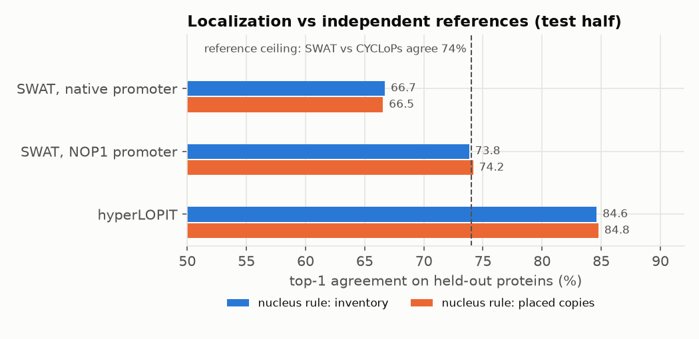

- **Tuned on dev, tested once:** the nucleus/cytosol split of nucleocytoplasmic proteins from CYCLoPs' Nucleus − Cytoplasm score (`inventory.NUC_K = 5`). Test top-1 rose from 64.0% to 66.8% against SWAT under native promoters and from 72.6% to 73.8% under the NOP1 promoter; hyperLOPIT was unchanged (84.6%).
- **Placed copies** score the same as the inventory (66.6 / 74.2 / 84.8% in build S; 67.4 / 74.6 / 84.8% in build R; 67.0 / 74.1 / 84.5% when the rule was adopted): packing shortfalls, the thinning of the nucleolus and the shell caps barely change the localization picture, and neither did the smaller cell.
- **Ceiling:** the two microscopy references (SWAT native, CYCLoPs) agree on only 74% of shared proteins.
- **Rejected:** membrane-bound fractions from lipid anchors and lipid-binding domains. Domain proteins image as cytosolic; lipid anchors gained 0.1 point on dev and nothing on test.
- **Earlier fixes found by checks:** two high-throughput mitochondrial proteomics papers assigned many abundant cytosolic enzymes to mitochondria and are no longer used; the high-confidence mitochondrial proteome (Morgenstern *et al.* 2017) removed 28 false assignments; Pil1's only UniProt location ("lipid droplet", from a proteomics screen) was replaced by the plasma membrane.

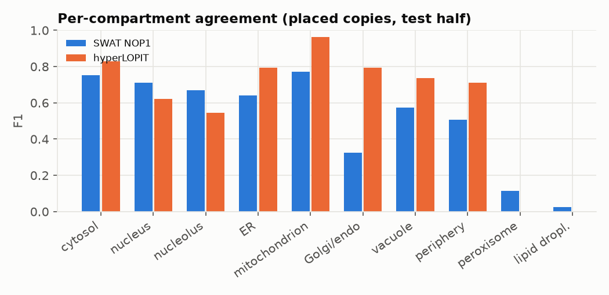

**Failed:** peroxisome, lipid-droplet and Golgi/endosome proteins are rarely called right (F1 0.03–0.32): the model spreads them over the cytosol or the ER. The 625 proteins without any localization annotation default to the cytosol and agree least (40% on dev).

**Topology fix (2026-11-11).** A literature review found that soluble proteins annotated to the vacuole, the Golgi or peroxisomes were all packed *inside* these organelles, including the free V-ATPase V1 subunits, the EGO complex, Tco89 and part of TORC1, Vac8, COPI, clathrin, COPII and Arf1/2 (680,000 copies). They now sit in shells on the organelles' cytosolic faces unless they can reach the lumen (signal peptide, Cvt cargo, peroxisomal matrix import). Soluble proteins without a signal peptide also lost their cell-wall shares (132,000 Ssa1/2 copies; Fus3, Kss1). The compartment classes of the benchmark do not change, so its scores do not either (test top-1 67.0 / 74.1 / 84.5% on placed copies); the effects show in proximity (section 12) and in simulated images (section 14).

### Nucleus against cytoplasm from raw images (round Q)

`validation/image_nc.py`. The first test on pixels rather than on published calls. The C-terminal SWAT library re-imaged for YeastRGB (Dubreuil *et al.* 2019; library: Meurer *et al.* 2018): 6,145 strains with mNeonGreen under the native promoter, each with the nuclear-envelope marker Nup49-mCherry, up to 225 single-cell crops per strain (9.7 GB of 16-bit images). Per cell the nucleus is segmented from the marker (Otsu threshold, largest object, filled; 60–600 px), the nuclear intensity is the mean inside the envelope and the cytoplasmic one the brighter half of a ring 2–7 px outside it (which leaves out the vacuole). Autofluorescence is taken from the dimmest 5% of strains. All of this was fixed on four strains before the comparison. 5,360 strains were measured, 1,680 are above 3 times the autofluorescence, and 1,066 of those have at least 90% of their model copies in nucleus and cytosol in build S (1,077 in build R).

| Build S | Proteins | Spearman, model vs measured log ratio | AUROC, model-nuclear vs model-cytosolic | Measured median log2(N/C): model-nuclear / model-cytosolic |
|---|---|---|---|---|
| dev half | 535 | 0.85 | 0.98 | 2.3 / −0.1 |
| **test half** | 531 | **0.81** | **0.98** | 2.2 / −0.2 |

- **Builds R and Q:** 0.80 and 0.98 on 538 test proteins (build R), 0.81 and 0.98 on 562 (build Q); neither the smaller cell nor the round-S changes move this test.
- **How independent:** the images are not an input. The nucleus/cytosol rule was tuned with CYCLoPs scores on the dev half, and CYCLoPs is also a C-terminal fusion library, so artefacts shared by C-terminal tags would not show. Blur and out-of-focus light compress the measured ratios, so only ranks are compared.
- **Not done:** ratios for other compartments, texture, and single-cell variation.

### Signalling proteins with established log-phase locations

`validation/kinase_localization.py`. Fifteen kinases and kinase complexes whose location in unstressed log-phase cells is established by dedicated studies (none of them a model input), each with a minimum share of placed copies, and six stress-only locations as negative controls (at most a given share). Citations are in the script and in the literature review.

| Protein | Expected in log phase | Share placed there | |
|---|---|---|---|
| Kog1 (TORC1) | vacuolar membrane face (≥ 80%) | 44% (the rest cytosol and plasma membrane; build R 45%) | failed |
| Tco89 (TORC1) | vacuolar membrane face | 100% | passed (was 0%, in the lumen) |
| Sch9 | partly on the vacuolar face (≥ 30%) | 0% | failed |
| Bcy1 (PKA regulatory) | nucleus (≥ 80%) | 36% (build R 39%) | failed |
| Tpk2 | nucleus (≥ 60%) | 64% (build R 70%) | passed |
| Pho85 (with Pho80) | nucleus (≥ 50%) | 3.0% (build R 3.5%) | failed |
| Rpn1 (26S proteasome) | nucleus (≥ 60%) | 80% (build R 82%) | passed |
| Pho4, Rim15, Hog1, Pbs2, Gal83 | cytoplasm | 92–100% | passed |
| Yck2, Slm1 | plasma membrane | 100% | passed |
| Pkh1 | plasma membrane / eisosomes (≥ 50%) | 0% | failed |
| Negative controls: Hog1, Pho4, Gal83 not nuclear; Ste5 not at the plasma membrane; Fus3, Ssa1 not in the wall | — | all passed | 6 of 6 (were 4 of 6) |

The failures share a cause: their compartment weights come from annotation rank or CYCLoPs groups that do not resolve these sub-cellular states. They are listed as work items, not curated one by one, so that the test stays a test.

## 7. The organisation layer (network-informed placement)

`pipeline/organisation.py`, `MODEL.md` 8.4. Where in its compartment a protein goes, and next to whom, is informed by STRING and by AlphaFold 3 pool predictions, with assumed strengths. These checks show the layer behaves as intended; none tests it against measured protein positions. They were measured on an earlier build and not repeated; in build S, 8.7 M copies tried for a partner and 4.9 M (20% of placed molecules) were placed next to one (build R 9.5 M and 4.7 M).

| Check | Result |
|---|---|
| AlphaFold 3 pool PAE as evidence of interaction | pairs at ≤ 2 Å: 73% Complex Portal pairs, 72% with IntAct evidence; at 6–8 Å still 50× and 10× above background |
| Network profiles predict co-complex membership | AUROC 0.996 (all variants 0.993–0.998) |
| Network profiles predict shared localization | AUROC 0.59 (moderate; chosen variant) |
| Network neighbours co-enriched in space | tile-density correlation vs profile similarity, Spearman 0.58 (0.71 for the 24 most abundant species) |
| Partners placed together | contact partner in contact 8.4% of the time, vs 1.3% for an abundance-matched control; loose partners within 15 nm 19.9% vs 14.0% |
| Crowding stays uniform | total crowding CV 0.040, vs 0.041 for random placement |

# Part B. Dynamics

## 8. Simulation numerics and calibration history

The viewer simulates boxes of the packed cell by rigid-body Brownian dynamics (`MODEL.md` 14); `simgpu/` runs the same physics on the cluster's GPUs, with many-body hydrodynamics.

- **Time step:** without attraction dt ≤ 0.2 ns is converged (GFP-sized D 61.9, 60.5, 60.1 µm²/s at dt 0.05, 0.1, 0.2 ns; 71.8 at 0.5 ns); attraction needs dt ≤ 0.05/ε ns.
- **Resolutions agree:** without attraction the schematic (sphere tree), mid (clusters of ~4 residues) and residue models give 42–54 µm²/s for GFP-sized molecules.
- **Electrostatics** (Debye–Hückel at 0.3 M) change diffusion by 0–4%: the Debye length is 0.55 nm.
- **Uniform stickiness rejected:** an attraction of 1.5–2 kT reproduces the GFP measurement numerically, but cluster counts show it does so by joining most molecules into one network within a microsecond (a gel). The earlier calibration matched the number this way; it was replaced.
- **Many-body hydrodynamics** (Ewald-summed Rotne–Prager–Yamakawa, polydisperse, with overlap correction; tested against Hasimoto's periodic result and for ξ-independence to 2 × 10⁻⁷): GFP-sized molecules reach 0.56 of their speed in water, against 0.62 with no hydrodynamic interaction and 0.36 with the mean-field factors. Far-field hydrodynamics does not explain the slow cytoplasm at this density.
- **History of the GFP-sized diffusion coefficient** in a 120 nm cytoplasm box: 77 µm²/s (excluded volume only) and 62 (mean-field hydrodynamics) at the earlier protein total (φ 0.106); 62 and 40 after the proteome was set by mass (φ 0.198). Measured: 8.7–21 µm²/s by FCS in budding yeast (Slaughter *et al.* 2007; Boeke *et al.* 2014; Pack *et al.* 2017) and 8.6 µm²/s by FRAP in fission yeast (Delivani *et al.* 2013). The remaining factor was calibrated on the literature benchmark (section 9): the viewer's default viscosity 2.75× gives 14.7 µm²/s, inside the measured range.

## 9. Diffusion

`validation/diffusion.py`, `simgpu/sweep.py`, `pipeline/diffusion_model.py`. A literature table of 93 measurements from 25 papers (each value quoted from the paper); 35 in-vivo values of soluble molecules in unstressed cells are scored, papers split by DOI hash.

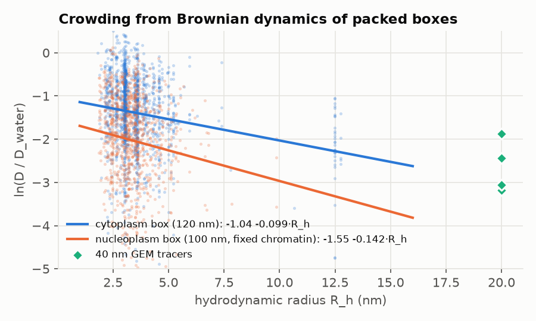

- **Mechanism, from simulation:** Brownian dynamics of boxes cut from the packed cell (mean-field hydrodynamics, 2 µs, 4 GPUs) give a size-dependent slowdown, ln(D/D_water) = −1.04 − 0.099 R_h/nm in the cytoplasm and −1.55 − 0.142 R_h/nm in the nucleoplasm with its fixed chromatin. Directly simulated 40 nm GEM particles move at 4–15% of their speed in water.
- **Tuned on training papers:** one remaining compartment factor (cytoplasm 0.365, which sets the viewer's default Viscosity 2.75×; nucleoplasm 0.26).
- **Hydrodynamic radii include disorder:** residues trimmed from AlphaFold models (pLDDT < 50) are restored as random coils for the radius (3,102 species; median factor 1.14).

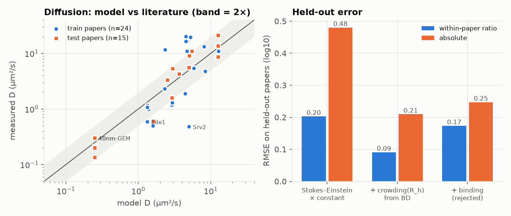

- **Test (held-out papers; build S, the same to two decimals as build R):** the size dependence from the packed boxes more than halves the within-paper ratio error (0.20 → 0.09 log10; 5 ratios) and the absolute error (0.48 → 0.21; 15 values, including the 40 nm GEMs below, which the size-blind null misses badly). When first scored, without the GEM values, these were 0.21 → 0.11 and 0.31 → 0.23. 40 nm GEM particles: predicted 0.25 µm²/s, measured about 0.3. The crowding term was simulated in boxes of an earlier build; the cytosol's density is unchanged (170 mg/mL in build S, 168 in build R, 170 in that build), so it was not re-run. The benchmark had stopped running after round Q, because two free-H2B rows used a non-native histone pair that is no longer built; they now use the library's H2B–H2A.Z dimer (same fold and size as the H2A–H2B dimer the measurements refer to).
- **Budding-yeast GEMs (held out, round P):** 40 nm GEMs in two studies from ETH IBC, read from figures (Gade *et al.* 2025: about 0.135 and 0.21 µm²/s in two experiments; Kunzi *et al.* 2026: 0.20). They were seen after the fit and are forced into the test split whatever their paper hash. The model predicts 0.25 µm²/s, 1.2–1.8× too fluid at this size; Delarue *et al.* 2018's ~0.3, in the training split, sits on the other side. Gade *et al.* also find that disassembling polysomes speeds 40 nm GEMs up about 1.4× while fewer idle ribosomes (stm1Δ) changes nothing; the simulation has no links between polysome ribosomes yet, so it cannot test this.
- **Rejected:** a binding term (RNA-interactome hits, pool partners) made the test error worse (0.17 / 0.25 in build S; 0.18 / 0.25 in build R). What slows Srv2 and Ede1 (about 10× and 2× below the size prediction) is not captured by generic scores.
- **Polysomes and large particles (test, failed; round Q; `simgpu/gade_test.py`).** Dissolving polysomes with hippuristanol speeds 40 nm GEMs 1.4–1.5× and 20 nm GEMs 1.3×, while *stm1Δ* (20–25% fewer ribosomes) changes nothing (Gade *et al.* 2025). The GPU engine got links between neighbouring ribosomes of one mRNA (entropic springs, as in the browser). Six 200 nm boxes of the cytosol of build Q (about 85 ribosomes and 20–44 links each), 10 µs, three seeds, 72 tracers per condition: without links the 40 nm particles are 1.02× as fast (95% interval 0.98–1.06 at a lag of 300 ns) and the 20 nm particles 0.98×; with 22% fewer ribosomes 1.05×. So tying ribosomes together does not slow large particles here, and removing ribosomes helps slightly, the opposite of the measured pattern. Missing: the mRNA itself as a chain (it is not a body in the simulation), a mesh across polysomes, and times beyond 10 µs (tracking measures at 10–100 ms). Not re-run on builds R and S (same cytosolic density and polysome statistics).
- **New held-out point:** free cytosolic GFP of Meinema *et al.* 2013 (13.6 ± 1.3 µm²/s, FRAP; a test paper by its DOI hash, added after the fit): predicted 12.7 µm²/s. Test absolute RMSE 0.22 log10 over 12 values.
- **Membrane proteins, calibrated (fit, 2026-11-11).** The simulation's fluid-bilayer Saffman–Delbrück value (about 4 µm²/s) is multiplied by a factor per membrane, the median of measured D ÷ predicted D for transmembrane proteins in unperturbed cells (`pipeline/membrane_diffusion.py`; FRAP values extracted with quotes into `membrane_diffusion_measurements.tsv`): plasma membrane 5.9 × 10⁻⁴ (Sso1, Snc1: 0.0025–0.0029 µm²/s; Valdez-Taubas & Pelham 2003), vacuole 0.016 (0.068 µm²/s), ER 0.035 (Sec61 and reporters 0.15–0.18 µm²/s; Meinema *et al.* 2013), nuclear envelope 0.079. Mitochondrial membranes, Golgi and peroxisomes have no yeast data and take the ER factor. There are too few papers for a held-out split, so this is a fit. FRAP measures micrometre-scale mobility with immobile fractions of 40–80% on the plasma membrane (Spira *et al.* 2012), which one factor per membrane cannot reproduce.

## 10. Encounter rates

`simgpu/encounter_bd.py`. In 2 µs Brownian dynamics of 120 nm boxes cut from the packed cell, an encounter is counted when two molecules' surfaces come within 1 nm after having been at least G2 apart. Observed counts are compared with the exact Smoluchowski rate for that definition, 4πD·R₁R₂/(R₂ − R₁)/V, using each molecule's long-time D measured in the same run, or its short-time D:

| Box | G2 | Encounters | Observed / predicted, long-time D | Observed / predicted, short-time D |
|---|---|---|---|---|
| Cytoplasm | 5 nm | 75,541 | 2.7 | 1.6 |
| Cytoplasm | 10 nm | 31,302 | 1.8 | 1.05 |
| Nucleoplasm | 5 nm | 59,788 | 4.0 | 1.1 |
| Nucleoplasm | 10 nm | 18,786 | 2.1 | 0.55 |
| Cytoplasm | 20 nm | 13,412 | 1.04 | 0.60 |
| Nucleoplasm | 20 nm (rerun 2026-11-12; the first run hit a pair-buffer overflow) | 3,300 | 0.66 | 0.14 |

Collisions close to contact follow the fast short-time diffusion inside the crowding cage, so a molecule re-collides with a neighbour two to four times more often than bulk diffusion predicts. As the separation required before a new encounter grows, the count approaches the long-time prediction. The ratios hold across molecule sizes (cytoplasm, G2 = 5 nm: 2.5–3.2 in every size bin). For kinetic models: the rates of section 13 (long-time in-vivo D) are rates of *new* encounters from the bulk; within one encounter a pair collides several times.

At G2 = 20 nm the cytoplasm matches the well-mixed long-time prediction (1.04), but the nucleoplasm falls below it (0.66). There, molecules' long-time D is only 0.15 of their short-time D (cytoplasm 0.47): the fixed chromatin obstructs them, and the well-mixed formula overestimates new nuclear encounters by about 1.5×.

# Part C. Emergent organisation and proximity

## 11. Condensates: negative result

`pipeline/condensates.py`. Could membrane-less compartments emerge from generic interaction data at the model's concentrations? Interaction energies came only from AlphaFold 3 pool scores (PAE converted to an IntAct likelihood ratio), RNA-interactome capture and IDR sticker residues; weights were set on the nucleus (nucleolus as calibration) and frozen.

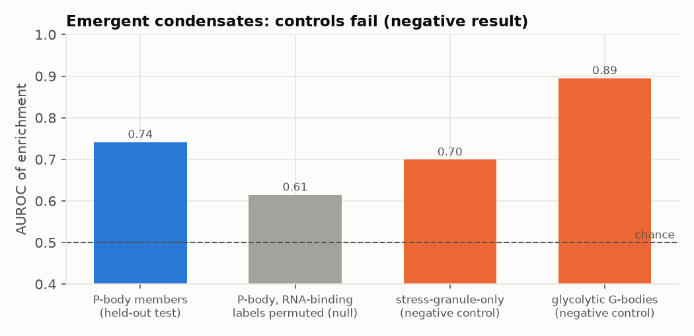

P-body members were enriched (AUROC 0.73), but so were the negative controls (stress-granule-only 0.72, hypoxia-induced glycolytic G-bodies 0.91), the AlphaFold pool network added nothing, and no phase separation occurred at the calibrated scale. Since round S the test and its stress control run with every validation (`validation/cond_test.py` in `validate_all.sh`); on build S: P-bodies 0.74 (0.59–0.64 with permuted RNA-binding labels, 0.74 with a permuted pool network or RNA binding alone), stress-granule-only 0.70, G-bodies 0.89; the log-phase cytosol is stable, and an in-silico stress that releases the mRNA from polysomes (free mRNA 0.2 → 0.9) changes neither the stability nor the enrichments. This shows that RNA-binding proteins co-enrich with RNA, not that P-bodies emerge. The model places no condensates.

## 12. Proximity: the packed cell against proximity labelling, PCA and cross-linking

`pipeline/contacts.py`, `validation/proximity_sets.py`, `validation/proximity_test.py`. Nothing here was tuned.

**Model side.** For every placed molecule, a GPU pass finds all other molecules whose sphere-tree surface comes within 2, 5 or 10 nm (35.8 M molecules, 822 M spheres, 9.5 min on 4 RTX 4090s in the larger cell of builds up to Q; build S has 25.3 M molecules). The contact search uses the library sphere trees, not the finer packing shapes of build S. For each protein pair this gives P(a copy of A has a B within g) and the mean number of B neighbours.

**Data side.** BioGRID 5.0.263, *S. cerevisiae*:

| Set | What it measures | Pairs in model (build S) | Baits with ≥ 5 partners |
|---|---|---|---|
| Proximity labelling (33 papers; BioID, TurboID, APEX) | biotinylation within ~10 nm of a bait | 5,030 | 71 |
| DHFR PCA (Tarassov *et al.* 2008) | fusion termini within ~8 nm in vivo | 2,349 | 267 |
| Cross-linking MS (8 papers) | lysines within ~3 nm | 691 | 72 |
| Kinase → substrate, in vivo (PhosphoGRID curation) | phosphorylation in cells | 1,033 | 36 |
| Kinase → substrate, in vitro arrays (Ptacek *et al.* 2005) | phosphorylation of purified proteins | 3,691 | 65 |

**Test.** For each bait, every protein in the model is a candidate partner and the known partners are positives. Four scores of increasing model content: the partner's abundance (the main bias of PCA and proximity labelling), shared compartments (the inventory's localization, well mixed), the packed-cell snapshot, and the snapshot with all candidates removed that share any complex with the bait (so curated assemblies cannot leak in).

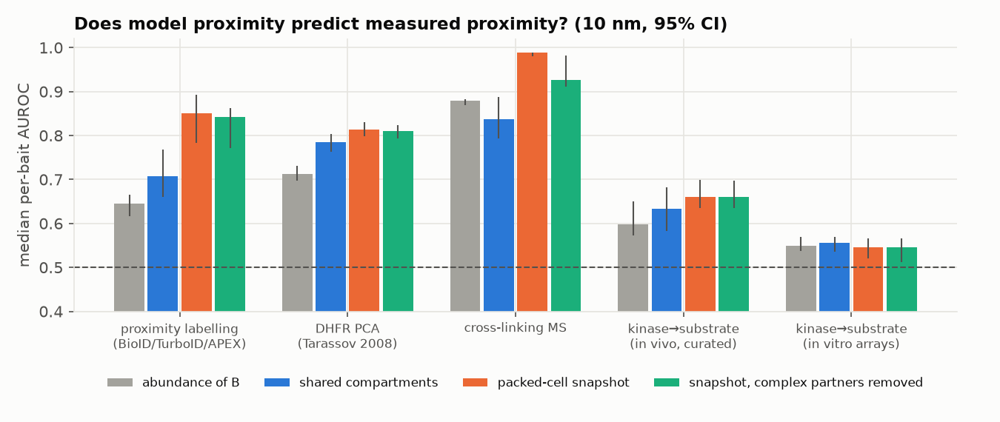

| Median per-bait AUROC, 10 nm (build S) | Abundance | Compartments | Snapshot | Snapshot, no shared complex |
|---|---|---|---|---|
| Proximity labelling | 0.64 | 0.71 | **0.85** | 0.84 |
| DHFR PCA | 0.71 | 0.79 | **0.81** | 0.81 |
| Cross-linking MS | 0.88 | 0.84 | **0.99** | 0.93 |
| Kinase → substrate, in vivo | 0.60 | 0.63 | **0.66** | 0.66 |
| Kinase → substrate, in vitro | 0.55 | 0.56 | 0.55 | 0.55 |

Build R gave the same values within 0.01, except cross-linking without shared complexes (0.96) and the snapshot for proximity labelling without shared complexes (0.83). At a 2 nm gap the snapshot gives 0.81 for proximity labelling (build R 0.81). This table, as written up to build R, held values of an earlier build (0.82 for proximity labelling and PCA).

- **The 3D cell carries information beyond compartment labels.** Proximity-labelling partners are predicted clearly better by the packed snapshot than by shared compartments (0.84–0.85 vs 0.71), also when complex partners are excluded. The topology fix (section 6) raised PCA from 0.80 to 0.82 and cross-linking from 0.97 to 0.99: coat proteins and V1 subunits now sit next to their membrane partners. The gain comes from sub-compartment structure the inventory labels lack: peripheral shells of membranes, polysomes, ER-bound ribosomes, nuclear pores, the arrangement of organelles.
- **Kinases.** Substrates that are phosphorylated in cells are co-localized with their kinase in the model; substrates found on protein arrays (no localization constraint) are not (section 13).
- **Caveats.** Proximity-labelling preys are partly the bait's stable complex partners; cross-linking MS is dominated by ribosomes and other abundant complexes (abundance alone gives 0.88). The test measures co-localization, not specific binding: the model has no specific interactions outside curated complexes.

**A second kinase–substrate curation** (Yeast KID; Sharifpoor *et al.* 2011), split by evidence type and leaving out KID's own co-localization evidence: pairs with low-throughput in-vivo phosphorylation evidence (48 kinases with ≥ 5 substrates in build S) reach AUROC 0.65 (compartments) and 0.62 (snapshot; build R 0.59); in-vitro-only pairs 0.56 / 0.54 and genetic-only pairs 0.54 / 0.54. This reproduces the PhosphoGRID result with an independent curation.

**Inside mitochondria: a negative result** (`validation/singh2020_test.py`). Quantitative BioID of 40 baits of the mitochondrial gene-expression machinery against a matched matrix control (Singh *et al.* 2020; all preys mitochondrial): per-bait AUROC for enriched preys 0.51 (compartments), 0.41 (snapshot; build R 0.42), 0.36 (abundance). Normalising to a control removes the abundance signal that drives the other tests, and the model has no organisation inside mitochondria beyond the matrix / membrane / IMS split. When this test was first run the matrix was only 40% filled; in build S it holds 98.5% of its proteins, and the result is the same. The model does not predict proximity inside an organelle.

**Binding is not contact: a negative result.** FCCS of 33 pairs of endocytic proteins in the cytoplasm (Boeke *et al.* 2014; 13 with detected co-diffusion): the model's contact probability does not separate detected from undetected pairs (AUROC 0.41 at 2 nm, 0.38 at 10 nm in build S; 0.43 and 0.42 in build R; shared complex 0.50). All these proteins share the endocytic cortex; which of them bind is a matter of affinity, which the model does not have.

**PCA with tested negatives** (`validation/ppiseq_test.py`). PPiSeq (Liu *et al.* 2020) tested 1.66 million ordered pairs of the DHFR collection at native promoters in SD medium; 1.44 million unordered pairs map onto the model, 4,432 of them called interactions (build S). Scores are expected numbers per cell, so all three carry abundance (build S; build R the same within 0.01):

| Score (10 nm) | Pooled AUROC | AUROC within abundance deciles | Spearman with fitness |
|---|---|---|---|
| Abundance N_A·N_B | **0.74** | 0.53 | 0.05 |
| Shared compartments | 0.68 | **0.65** | 0.04 |
| Packed snapshot | 0.73 | 0.63 | 0.06 |

- PCA calls are driven first by abundance; at equal abundance, localization still separates interacting from non-interacting pairs (0.65 vs 0.53).
- Here the packed arrangement adds nothing beyond compartment labels, unlike for proximity labelling. Two reasons are likely: a single snapshot gives zero neighbours for most pairs of rare proteins (sampling noise the smooth compartment score does not have), and DHFR complementation, an irreversible end-point readout over the whole culture, integrates over the cell rather than resolving sub-compartment structure.
- Excluding pairs that share a curated complex changes nothing (0.64 / 0.62).

## 13. Pair statistics for kinetic models

`pipeline/encounters.py` → `work/contacts/encounters_kinases.parquet` (131 kinases × 5,700 proteins; the table is regenerated with every validation run, but the numbers below are from an earlier build and were not re-read for build S). Per pair: P(B within 2 / 10 nm of A), the compartment-level and local concentration of B around A (µM), and a diffusion-limited encounter rate 4π(D_A + D_B)(R_A + R_B)·c with in-vivo D from section 9.

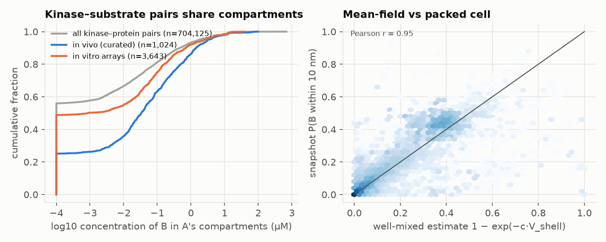

- **Kinase–substrate pairs share compartments** (left): only 24% of in-vivo pairs share no compartment in the model, against 49% of in-vitro array pairs and 56% of all kinase–protein pairs.
- **A well-mixed approximation works for most pairs** (right): 1 − exp(−c·V_shell) from compartment concentrations predicts the packed snapshot's P(B within 10 nm) with r = 0.94. Departures mark pairs whose sub-compartment arrangement matters (membrane shells, polysomes, scaffolds); the table lists them as `enrichment` = local / compartment concentration (median 1.2 for abundant partners: crowded packing slightly enriches contacts).
- **Gaps revealed:** TORC1 (Tor1) never comes near the EGO complex (Gtr1) in the model, because TORC1 is not placed on the vacuole membrane.

# Part D. Imaging

## 14. Simulated microscopy

`pipeline/microscopy.py`. Every copy of a protein carries one fluorophore. The positions are convolved with a scalar Debye point-spread function (NA 1.4 oil, 510 nm emission; in-focus FWHM 195 nm against 186 nm theory; out-of-focus light conserved), sampled on 65 nm camera pixels, with shot and read noise. Midplane through the nucleus:

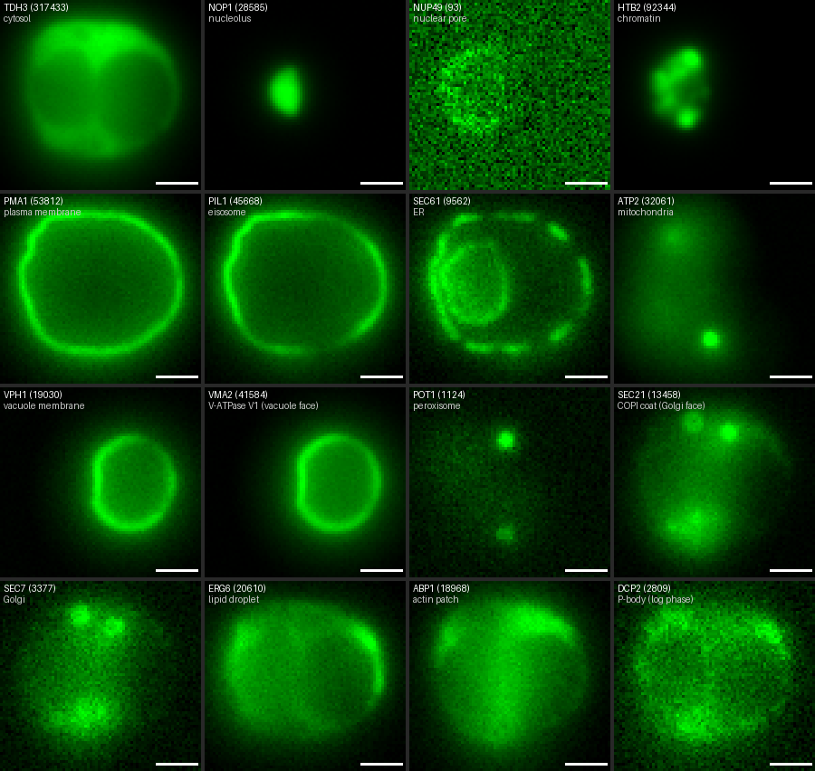

Maximum projections of whole-cell z-stacks (22 planes, 200 nm apart):

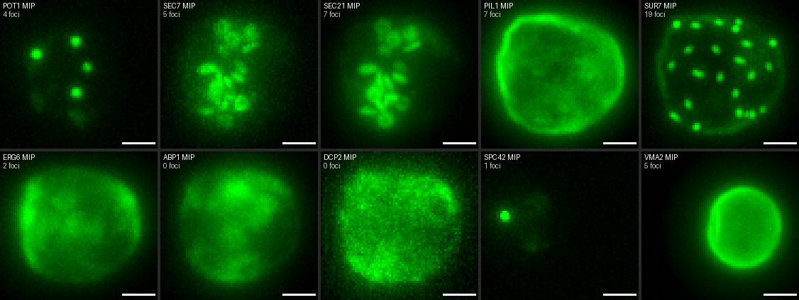

**Reproduced qualitatively:** cytosolic proteins excluded from nucleus and vacuole (TDH3, PAB1); NPC rim punctate (Nup49); nuclear-envelope ring plus cortical ER (Sec61); cortical mitochondrial tubules (Atp2); vacuolar rims (Vph1, and the V-ATPase V1 subunit Vma2 on the vacuole face); COPI (Sec21) as Golgi puncta (both filled organelle lumens before the topology fix); a few peroxisomes (Pot1, 4 foci) and Golgi cisternae (Sec7, 5 foci); eisosome patches for Sur7 (19 foci) (spot counts of build S, `work/microscopy/spot_counts.json`; build R: Pot1 3, Sec7 13, Sur7 20; Vma2 on the vacuole face 0 spots in build R and 5 in build S); a nucleolar cap (Nop1); P-body components diffuse in log phase (Dcp2, Edc3, as expected without stress).

**Fixed in build N:** Spc42 was spread through the nucleus; with the SPB plaques built (`pipeline/spb.py`) it is one spot, as in cells, over a faint haze of the copies that do not fit into one SPB.

**Wrong** (each one a model error, and a work item):

- **Pil1** coats the whole plasma membrane evenly. In cells, Pil1-GFP is almost all in eisosome puncta. The built eisosome coats hold only 7.6% of the cell's Pil1/Lsp1 (build S); the rest is free near the membrane.
- **Erg6** is diffuse; in cells it marks lipid droplets.
- **Abp1** is mostly diffuse; in cells actin patches are bright cortical dots.

### Foci per cell against an image screen

`validation/microscopy_idr0078.py`. Data: wild-type control cells of the endocytic-compartment screens of Mattiazzi Usaj *et al.* 2020 (IDR idr0078; 33,000–67,000 cells per marker; log phase, synthetic medium): CellProfiler objects per cell in maximum projections of 5 sections 0.8 µm apart, imaged on a spinning-disk confocal with a 60× water objective and 0.108 µm pixels. The model was rendered with the same optics from 9 viewpoints and its objects counted by threshold segmentation (closer to CellProfiler) and by contrast spots.

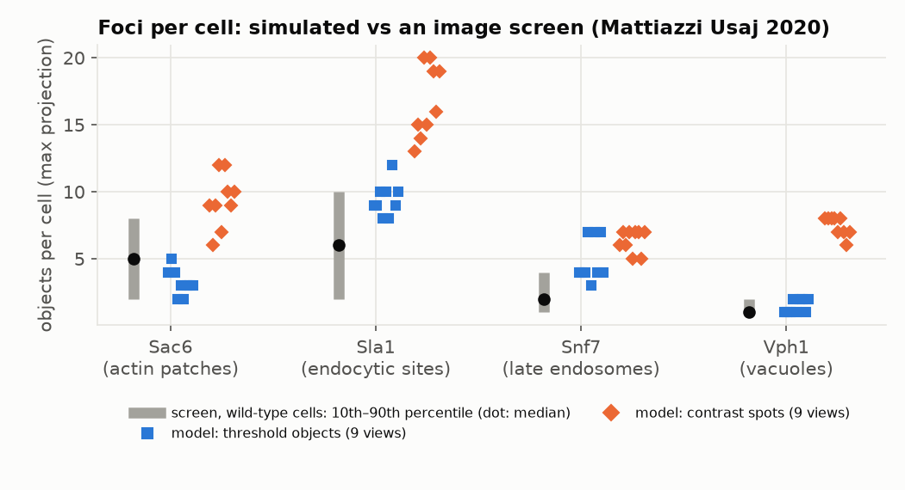

| Marker | Model, build S (threshold objects, median and range over 9 views) | Build R | Screen median [10th–90th percentile] |
|---|---|---|---|
| Sac6 (actin patches) | 3 (2–5) | 3 (2–6) | 5 [2–8] |
| Sla1 (endocytic sites) | 9 (8–12) | 10 (9–15) | 6 [2–10] |
| Snf7 (late endosomes) | 4 (3–7) | 6 (5–8) | 2 [1–4] |
| Vph1 (vacuoles) | 1 (1–2) | 2 (1–3) | 1 [1–2] |

- Actin patches and vacuoles agree; with one vacuole, Vph1 now gives the screen's single object in most views. Endocytic sites are too many: the model spreads its 29 sites evenly over the cortex, while in the (budding) screen cells endocytosis is polarized to the bud and sites merge optically. Late endosomes are somewhat too many.
- The segmentation is not the screen's own software, and the screen's cells are a budding population; compare magnitudes and ranking, not exact numbers. The contrast-spot counter over-counts textured membrane signal (Vph1 rims) and is not used for the comparison.

## 15. Stress controls

The model is of unstressed log-phase cells. Stress-induced structures must not appear and serve as negative controls:

- stress granules and G-bodies: not placed (correct), but the generic condensate model in section 11 would have enriched their members as much as P-bodies (failed control);
- P-body components diffuse in simulated micrographs (correct).

## 15a. The smaller cell (round R): every test before and after

Build Q is the last build of the culture-mean cell (5.0 pg of protein, 42 µm³); build R is the G1 cell (3.5 pg, 34 µm³; vacuole 17% instead of 9%, nucleus 7% instead of 8%, 93 pores instead of 117, tRNA and mRNA times 0.7). Both builds share all other rules. The cell volume was chosen to keep the cytosol's density; nothing else was tuned for round R, and no test data were used to choose the new values.

| Test or check | Build Q | Build R | Reading |
|---|---|---|---|
| Core histones ÷ nucleosome need | 1.29 | 0.90 | better |
| Nucleoporins ÷ pore need (median) | 1.5 | 1.36 | better; depends on the assumed pore number |
| Ribosomes ÷ counts from rRNA | 1.5–1.6 | 1.06–1.13 | better |
| Copies vs Das 2026 (median ratio; within 2×) | 1.75; 42% | 1.23; 46% | better |
| Copies vs Ho 2018 (median ratio) | 0.53 | 0.37 | worse (a compressed culture-average scale) |
| Whole-cell protein vs 71 mg/mL (Kunzi 2026) | 119 | 103 | better, still high |
| Cytoplasmic dry mass vs ~200–225 mg/mL | 225–240 | 240–255 | worse |
| Cytosolic ribosomes vs 23 µM (cryo-ET) | 17.1 | 17.0 | unchanged (too low) |
| Vacuole vs 17.2% of G1 cells | 9% | 17.1% | now an input |
| Matrix density ÷ cytosol (absorption 1.10) | 0.82 | 0.89 | better |
| Placed copies, all / outside mitochondria | 96.7 / 98.6% | 97.5 / 98.9% | better |
| Matrix / Golgi face / nucleolus placed | 66 / 76 / 81% | 75 / 84 / 80% | better / better / same |
| Overlaps, packed molecules (limit 10⁻⁵) | 3.7 × 10⁻⁶ (all pairs) | 6.4 × 10⁻⁶ | within the limit |
| Overlaps, with built actin structures | not separated | 2.65 × 10⁻⁵ | fails; an older defect made visible |
| Cvt complex diameter vs ~150 nm vesicles | 180 nm | 162 nm | better |
| Translocon-engaged ribosomes vs 7,715 | 7,700 | 5,507 | worse |
| TORC1 vs ~200 | 75 | 51 | worse |
| ER ribosomes per µm² (550–900) | 785 | 796 | unchanged |
| Ribosomes in chains / tight pairs / collided | 61 / 10.4 / 3.9% | 61 / 10.0 / 3.8% | unchanged |
| Mitochondrial mRNAs (Spearman / AUROC) | 0.44 / 0.68 | 0.35 / 0.61 | worse (fewer mRNAs per gene) |
| ER mRNAs (Spearman / AUROC) | 0.35 / 0.90 | 0.35 / 0.89 | unchanged |
| Hi-C, balanced: cis / slope / CEN / TEL | 0.55 / −1.03 / 7.1× / 2.3× | 0.51 / −1.04 / 6.0× / 1.9× | within realisation noise |
| R(s) at 100 and 200 kb (Arbona: 393–553, 561–792 nm) | 403, 536 | 376, 467 | worse |
| Nucleosome occupancy AUROC; DNase core ÷ linker | 0.75; 0.66 | 0.76; 0.66 | unchanged |
| Silent chromatin: H4K16 hypoacetylated | 78% | 78% | unchanged |
| tRNA genes within 250 nm of the nucleolus vs nucleosomes | 33% vs 36% | 35% vs 43% | still fails |
| Localization top-1, placed copies (test) | 67.2 / 74.3 / 84.5% | 67.4 / 74.6 / 84.8% | unchanged |
| Image N/C: Spearman / AUROC (test) | 0.81 / 0.98 | 0.80 / 0.98 | unchanged |
| Signalling proteins: positives / negative controls | 10 of 15 / 6 of 6 | 10 of 15 / 6 of 6 | unchanged |
| Proximity labelling / PCA / cross-linking (per-bait AUROC) | 0.85 / 0.81 / 0.99 | 0.85 / 0.81 / 0.99 | unchanged |
| Proximity labelling at a 2 nm gap | 0.84 | 0.81 | slightly lower |
| PPiSeq at equal abundance (snapshot) | 0.63 | 0.63 | unchanged |
| Kinase → substrate in vivo (PhosphoGRID / KID) | 0.66 / 0.60 | 0.66 / 0.59 | unchanged |
| Diffusion benchmark (test ratio / absolute RMSE) | 0.11 / 0.21 | 0.09 / 0.21 | unchanged (two species re-mapped) |
| Foci per cell: Sac6, Sla1, Snf7, Vph1 (screen 5, 6, 2, 1) | 4, 10, 5, 1 | 3, 10, 6, 2 | unchanged |

**Reading.** The stoichiometric anchors, the copy-number check against the independent proteome, the vacuole, the matrix and the packing completeness improve; localization, proximity, diffusion and the nucleosome tests do not move. Worse are the long-range chromatin distances (a smaller nucleus), the mitochondrial mRNA test (fewer molecules per gene), the dry-mass sum, and two counts that had matched culture-scale measurements (translocon-engaged ribosomes, TORC1). The ribosome concentration stays 26% below cryo-ET: making the cell smaller does not help when its ribosomes shrink with it.

**Two stale inputs were found while writing this section.** The per-protein feature table had not been regenerated since 2026-11-11, so the copy-number check and the abundance baselines of the proximity tests still read 5.0 pg numbers after the build; and the diffusion benchmark had stopped running after round Q. Both are fixed and re-run, and the build and validation scripts now include them. The stoichiometric anchors and the organelle fractions of the literature check were also still computed from hard-coded constants in the first run.

## 15b. Round S: every test before and after

Build R (`main`, 5138268) and build S (9568da3, run `runs/S3_seed0`) share the protein copy numbers, the cell volume and the mRNA draw; the inventory's nucleus/cytosol split uses the built volumes since build S (`MODEL.md` 4.2). Build S changes the geometry (one vacuole, rebuilt mitochondria, nucleolus on the vacuole side, no pores in the junction, 400 nucleation tries per microtubule) and the packing (six rounds by size class, packing shapes of 15 residues per sphere, capped membrane-face shells, uniform thinning of the nucleolus), and rebuilds the structure library in stage 0 (82 re-oriented transmembrane proteins, free H2B, the amphiphysin entry). No test data were used to choose these changes; the vacuole and mitochondria follow measurements that are inputs. Both are single builds at seed 0, so differences of the size that one realisation produces (sections 5 and 5a) are noise.

| Test or check | Build R | Build S | Reading |
|---|---|---|---|
| Placed copies: of the request; outside mitochondria | 97.5%; 98.9% | 99.3%; 99.5% | better (acceptance passed) |
| Placed share of the inventory by sphere volume | 96.0% | 98.1% | better |
| Species under half / under 80% placed | 76 / 238 | 10 / 60 | better |
| Matrix / nucleolus (of inventory) / inner membrane placed | 75 / 80 / 98% | 98.5 / 84 / 87% | better / better (thinned) / worse |
| Golgi cytosolic face placed | 84% of the full request | 97.7% of a request capped at 0.61 | capped |
| Tile seams: face (first / last pass) against interior | 0.49 / 0.20 against 0.40 | 0.41 / 0.40 against 0.41 | fixed |
| Membrane-face copies outside their shell | 4–17% | 0% | fixed |
| Overlaps, packed molecules (limit 10⁻⁵) | 6.4 × 10⁻⁶ | 3.4 × 10⁻⁶ | within the limit |
| Overlaps, with built actin structures | 2.65 × 10⁻⁵ | 1.87 × 10⁻⁵ | still fails |
| Beads outside their region | 4.1 × 10⁻⁵ | 6.7 × 10⁻⁵ | worse, not analysed |
| Vacuole: compartments; membrane; sphericity (G1 cells: one; 0.98) | 12; 40.1 µm²; 0.39 | 1; 16.0 µm²; 0.98 | now an input |
| Matrix density ÷ cytosol (absorption 1.10) | 0.89 | 1.05 | better |
| ATP synthase dimers | 6,257 | 1,940 | fewer: short cristae (an input) |
| Cytosolic ribosomes vs 23 µM (cryo-ET) | 17.0 | 17.1 | unchanged (too low) |
| ER ribosomes per µm² (550–900) | 796 | 827 | unchanged |
| Translocon-engaged ribosomes vs 7,715 | 5,507 | 5,586 | unchanged (too few) |
| TORC1 vs ~200 | 51 | 54 | unchanged (too few) |
| Cvt complex diameter vs ~150 nm | 162 nm | 168 nm | unchanged |
| Ribosomes in chains / tight pairs / collided | 61 / 10.0 / 3.8% | 62 / 10.2 / 3.8% | unchanged |
| Mitochondrial mRNAs (Spearman / AUROC) | 0.35 / 0.61 | 0.45 / 0.66 | realisation noise (same mRNAs) |
| ER mRNAs (Spearman / AUROC) | 0.35 / 0.89 | 0.35 / 0.89 | unchanged |
| Hi-C, balanced: cis / slope / CEN / TEL | 0.51 / −1.04 / 6.0× / 1.9× | 0.50 / −1.01 / 5.9× / 3.3× | within realisation noise |
| R(s) at 100 and 200 kb (Arbona: 393–553, 561–792 nm) | 376, 467 | 398, 516 | better; 200 kb still below |
| Telomere–pole distance vs arm length (Spearman) | 0.85 | 0.92 | — (a build rule) |
| Nucleosome occupancy AUROC; DNase core ÷ linker | 0.755; 0.66 | 0.755; 0.66 | unchanged |
| Silent chromatin: H4K16 hypoacetylated; Sir4 enrichment | 78%; 37× | 77%; 36× | unchanged |
| tRNA genes within 250 nm of the nucleolus vs nucleosomes | 35% vs 43% | 23% vs 33% | still fails |
| Localization top-1, placed copies (test) | 67.4 / 74.6 / 84.8% | 66.6 / 74.2 / 84.8% | unchanged |
| Image N/C: Spearman / AUROC (test) | 0.80 / 0.98 | 0.81 / 0.98 | unchanged |
| Signalling proteins: positives / negative controls | 10 of 15 / 6 of 6 | 10 of 15 / 6 of 6 | unchanged |
| Proximity labelling / PCA / cross-linking (per-bait AUROC, 10 nm) | 0.85 / 0.81 / 0.99 | 0.85 / 0.81 / 0.99 | unchanged |
| PPiSeq at equal abundance (snapshot) | 0.63 | 0.63 | unchanged |
| Kinase → substrate in vivo (PhosphoGRID / KID) | 0.66 / 0.59 | 0.66 / 0.62 | unchanged |
| FCS concentrations of endocytic proteins (Spearman; model ÷ measured) | 0.77; 2.1× | 0.78; 2.3× | unchanged |
| Diffusion benchmark (test ratio / absolute RMSE) | 0.09 / 0.21 | 0.09 / 0.21 | unchanged |
| Foci per cell: Sac6, Sla1, Snf7, Vph1 (screen 5, 6, 2, 1) | 3, 10, 6, 2 | 3, 9, 4, 1 | closer |
| Condensate test: P-bodies / stress-granule-only / G-bodies (AUROC) | not run (last run 2026-11-11: 0.73 / 0.72 / 0.91) | 0.74 / 0.70 / 0.89 | still a failed control |

**Reading.** The packing changes did what they were measured to do: the shortfall in the matrix is gone, the dropping of mid-sized species is replaced by one reported thinning factor, the tile seams and the membrane-face shells are clean, and the other packing numbers improve, except containment, which rose from 4.1 to 6.7 × 10⁻⁵ and is not yet understood. The rebuilt mitochondria create one new shortfall: the inner membrane is a third of its former area and holds 87% of its proteins. The tests against independent data do not move beyond what one realisation moves them (the mitochondrial mRNA test by 0.1, telomere clustering from 1.9× to 3.3×); 100 kb chromatin distances are back inside the imaging range. The failures stay failures: tRNA genes at the nucleolus, the stress controls of the condensate test, too few ribosomes against cryo-ET and translocon counts, and the ribosomal-protein share of the proteome (section 1).

## 16. Validation history across build rounds

| Date | Round | Instances | Placed | Clash rate | Cytosol (mg/mL) |
|---|---|---|---|---|---|
| 2026-11-03 | assemblies from PDB and AlphaFold (52.7% of protein mass in assemblies, was 34.7%) | 22.7 M | — | 3.2 × 10⁻⁶ | — |
| 2026-11-08 | measured localization (CYCLoPs), mitochondrial proteome, mitoribosomes | — | 98.0% | 2.6 × 10⁻⁶ | — |
| 2026-11-09 | eisosomes, endocytic invaginations, chromatin, Pol II, polyP, contact site | — | 97.8% | 6.3 × 10⁻⁷ | 91 |
| 2026-11-10 | proteome total by mass (2.7 → 5.0 pg), squeeze relaxation | 35.8 M | 94.7% | 9.3 × 10⁻⁶ | 163 |
| 2026-11-11 | nucleus rule from CYCLoPs scores | 35.8 M | 94.7% | 8.2 × 10⁻⁶ | 163 |
| 2026-11-11 | cytosolic faces of vacuole, Golgi, peroxisomes; no wall share without signal peptide; proteasome split from subunits | 35.7 M | 94.5% | 1.0 × 10⁻⁵ | 165 |
| 2026-11-11 (K) | chromatin fibre (20 nm), gene-specific mRNAs, flexible polysome linkers, mitochondria 3% | 35.8 M | 95.9% | 1.2 × 10⁻⁵ (mRNA tails through RAC) | 168 |
| 2026-11-11 (L) | measured nucleosome map, 60 nm fibre, kinetochores, origins, ChIP-exo proteins; per-gene UTRs, poly(A), TE; mitochondrial mRNAs; Pab1/eIF4E; RAC as thread obstacle | 35.7 M | 95.9% | 7.2 × 10⁻⁶ | 168 |
| 2026-11-11 (M) | telomere steering fix (arms reach their foci) | 35.7 M | 95.9% | 7.7 × 10⁻⁶ | 168 |
| 2026-11-12 (N) | Jurkat-model ideas: 10× attempt budget, ER topology fix, SPB plaques, outer kinetochores, tRNA-gene and telomere proteins, pore receptors, ER-translated mRNAs, random polysome spacing | 36.0 M | 96.5% | 8.4 × 10⁻⁶ | 170 |
| 2026-11-12 (O) | mRNA layouts without introns (CDS from SGD coding segments; 5′ UTR introns subtracted) | 36.0 M | 96.5% | 7.3 × 10⁻⁶ | 170 |
| 2026-11-12 (P) | round-2 data (Rap1, Sir, SPB stoichiometry), collided disome pose, 42 tRNA isoacceptors (Boltz-2) | 36.0 M | 96.6% | 9.3 × 10⁻⁶ | 170 |
| 2026-11-12 (Q) | Sir-bound nucleosomes from Sir3 ChIP-seq, nucleoporins per pore, native histone pairs, curated homo-oligomers, Asc1/Stm1 on the ribosome, abundance-aware heterodimers; tests on raw images, DNase-seq, polysome links | 35.3 M | 96.7% | 3.7 × 10⁻⁶ | 169 |
| 2026-11-12 (R) | the G1 cell: 3.5 pg of protein in 34 µm³, vacuole 17%, nucleus 7%, 93 pores, tRNA and mRNA × 0.7; proteins this cell does not have set to zero | 24.9 M | 97.5% | 6.4 × 10⁻⁶ (2.65 × 10⁻⁵ with built actin structures) | 168 |
| 2026-11-13 (S) | isolated builds, master seed, build stamp, stage 0 library; one vacuole; mitochondria rebuilt; nucleolus on the vacuole side; no pores in the junction; packing in 6 rounds with 15-residue shapes, shell caps and uniform thinning | 25.3 M | 99.3% (99.1% of the inventory) | 3.4 × 10⁻⁶ (1.87 × 10⁻⁵ with built actin structures) | 170 |

Raising the proteome to its measured mass brought the cytosol from 91 to 163 mg/mL and the dry-mass estimate into the measured range, at the cost of packing completeness in the small compartments. Round R then took the cell from the culture average to one G1 cell at the same cytosolic density (section 15a). Round S made builds reproducible and comparable and removed measured packing artefacts (section 15b).

## 17. What is not yet tested

- **Image-based localization beyond nucleus against cytoplasm:** other compartments, texture and radial profiles from the C-SWAT images now on disk (section 6 tests only the nuclear/cytoplasmic ratio); CYCLoPs intensities (Chong *et al.* 2015).
- **Image texture and radial profiles** of simulated micrographs against single-cell crops (DeepLoc; Kraus *et al.* 2017).
- **Cross-link distances** of in-cell cross-linking MS mapped onto the placed copies.
- **TurboID with matched controls** (Favre *et al.* 2026: all 60S ribosomal proteins as baits).
- **Chromatin:** which chromosomes contact which (Spearman 0.06–0.19 against Hi-C); locus–envelope distances of active genes; cohesin and condensin; per-nucleosome occupancy below 1.
- **mRNA:** per-gene ribosome density against Arava *et al.* 2003 (the round-3 data arrived; compared ad hoc on build R, section 5, not yet a script in `validation/`); the polysome test of Gade *et al.* 2025 fails (section 9) and needs the mRNA as a physical chain; ER-translated mRNAs as membrane-bound polysomes; mRNP compaction.
- **Build-to-build spread:** build S is one build at seed 0. Replicate builds at other master seeds (`YC_SEED`) would give every number in this document a spread; until then, differences between builds of the size seen between R and S (section 15b) cannot be read as effects of a change.
- **Model errors to fix:** the copy numbers (ribosomal proteins 15.7% of protein mass against 29–32%; too few ribosome-free mRNAs; ribosomes against cryo-ET and translocon counts; a non-uniform scaling from the average cell to the G1 cell; section 1, planned as the next round); the cell volume, which dry mass and ribosome concentration pull in opposite directions (section 4); the 200 kb chromatin compaction; tRNA genes at the nucleolus; overlaps inside the built actin structures and the rise of containment in build S (section 3); the crowded inner mitochondrial membrane (section 3); endocytic sites (tip too wide, invaginations shallow, no ribosome exclusion zone; section 5); translating ribosomes drawn from the idle-ribosome structure, without tRNAs and factors (PDB audit, `pdb_audit_2026-11-12/`); the signalling-protein locations that fail (TORC1 and Sch9 on the vacuole, Bcy1 and Pho80–Pho85 nuclear, Pkh1 at eisosomes); how much of the Golgi coat pool is membrane-bound (now capped by a density rule, not measured); the mitochondrial volume (4.8% in glucose vs 2.9%) and the nucleolus, which is thinned rather than filled; TORC1 copy number; specific affinities for binding; the spindle pole body, eisosome coat and lipid-droplet errors (section 14); polysome compaction (section 5); peroxisome, lipid-droplet and Golgi localization (section 6).
